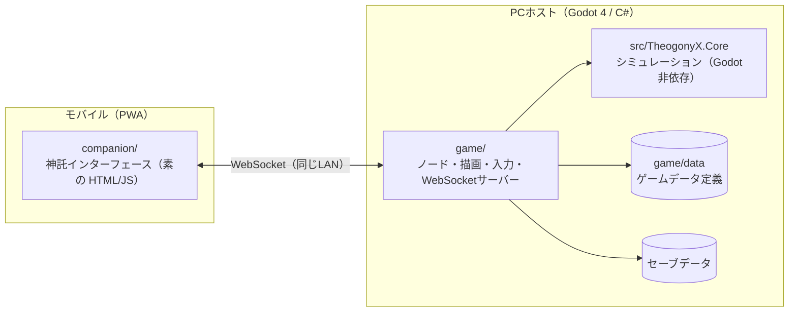
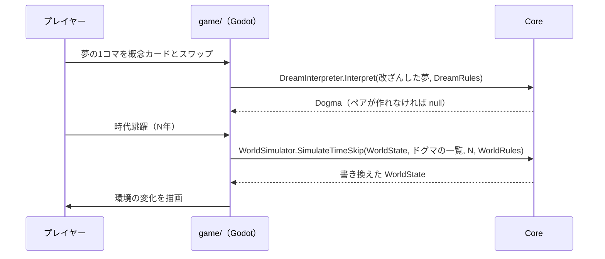

# アーキテクチャ概要

システムの今の姿を書く。常に最新に書き換え、各項目から根拠のADRへリンクする。経緯はADRに任せ、ここには書かない。

> 現在あるのは、コアループ（夢の解釈・時代跳躍）、地表の判定と時間の進め方（`TimeControl`）、それを描く Godot のメインシーン（`game/scenes/main/`。仮の単色タイル・HUD・操作ボタン・昼夜の環境光・予言者）である。コンパニオンとの通信（`CompanionHost`。HTTP で HTML/JS を配り、WebSocket でペアリングと画面の配信を行う）と、コンパニオンの画面（`companion/`。映像と、まだ枠だけの夢のカードの欄）もある。セーブデータは、まだ無い（下の図では予定として描いている）。

## 全体構成

## 主な処理の流れ

## 主な設計方針
| 方針 | 根拠 |
| :--- | :--- |
| シミュレーションを Godot 非依存の C# ライブラリに分け、xUnit でテストする | [ADR 0001](adr/0001-separate-core-library.md) |
| Godot プロジェクトを `game/` に置き、コアを `ProjectReference` で参照する | [ADR 0002](adr/0002-godot-project-in-game-dir.md) |
| 調整値はコードに書かず、ゲームデータ定義に置く | 未記録 |
| コンパニオンは同じLANの WebSocket でホストに接続する | 未記録 |
| 画面の配信は WebSocket のバイナリフレームで送り、先頭 2 バイトに種別とバージョンを置く | [ADR 0003](adr/0003-binary-frame-header.md) |

## 共通部品
新しく作る前に、ここにあるものを使う。共通部品を追加したら、この表にも追加する。

| 種類 | 置き場所 | 例 |
| :--- | :--- | :--- |
| UIのテーマ | `game/ui/theme/` | 色・余白・フォント（`main_theme.tres` を `project.godot` の `gui/theme/custom` に設定済み） |
| 翻訳ファイル | `game/locales/ui.csv` | 画面の文言（`ja`・`en`） |
| UIの共通シーン | `game/ui/common/` | （まだ無い） |

## ディレクトリと責務
| ディレクトリ | 責務 |
| :--- | :--- |
| `src/TheogonyX.Core/` | モデル・夢の解釈・ドグマ・時代跳躍・セーブ形式・通信メッセージの型。Godot に依存しない |
| `tests/TheogonyX.Core.Tests/` | コアの自動テスト（xUnit） |
| `game/` | Godot プロジェクト（`project.godot`）。シーン・描画・入力・ファイル入出力・WebSocket サーバー |
| `game/data/` | ゲームデータ定義（`symbols.json`・`rules.json`）と、それをコアの定義（`DreamRules`・`WorldRules`・`TerrainRules`・`AmbienceRules` など）に変換する `GameDataLoader` |
| `game/scenes/` | シーンとそのスクリプト（シーンごとにディレクトリを分ける） |
| `game/locales/` | 翻訳ファイル |
| `companion/` | モバイルのコンパニオン（素の HTML/JS） |
| `docs/protocol/` | ホストとコンパニオンの通信の契約 |
