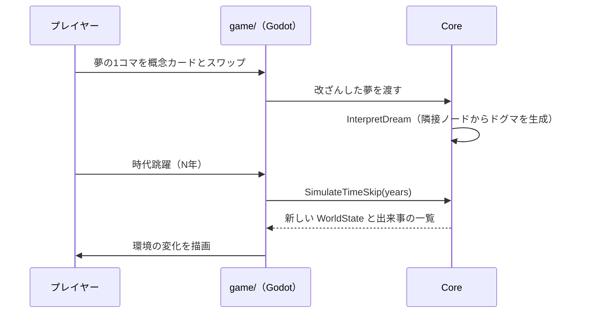

# アーキテクチャ概要

システムの今の姿を書く。常に最新に書き換え、各項目から根拠のADRへリンクする。経緯はADRに任せ、ここには書かない。

> 現在はコードが無く、下は最初のマイルストーン（MVP）で作る予定の構成である。作ったら今の姿に書き換える。

## 全体構成

## 主な処理の流れ

## 主な設計方針
| 方針 | 根拠 |
| :--- | :--- |
| シミュレーションを Godot 非依存の C# ライブラリに分け、xUnit でテストする | 未記録（ADR化の候補） |
| 調整値はコードに書かず、ゲームデータ定義に置く | 未記録 |
| コンパニオンは同じLANの WebSocket でホストに接続する | 未記録 |

## 共通部品
新しく作る前に、ここにあるものを使う。共通部品を追加したら、この表にも追加する。

| 種類 | 置き場所 | 例 |
| :--- | :--- | :--- |
| UIのテーマ | `game/ui/theme/` | 色・余白・フォント |
| UIの共通シーン | `game/ui/common/` | （まだ無い） |

## ディレクトリと責務
| ディレクトリ | 責務 |
| :--- | :--- |
| `src/TheogonyX.Core/` | モデル・夢の解釈・ドグマ・時代跳躍・セーブ形式・通信メッセージの型。Godot に依存しない |
| `tests/TheogonyX.Core.Tests/` | コアの自動テスト（xUnit） |
| `game/` | Godot プロジェクト（`project.godot`）。シーン・描画・入力・ファイル入出力・WebSocket サーバー |
| `game/data/` | ゲームデータ定義（記号・閾値など） |
| `game/locales/` | 翻訳ファイル |
| `companion/` | モバイルのコンパニオン（技術は未定） |
| `docs/protocol/` | ホストとコンパニオンの通信の契約 |
