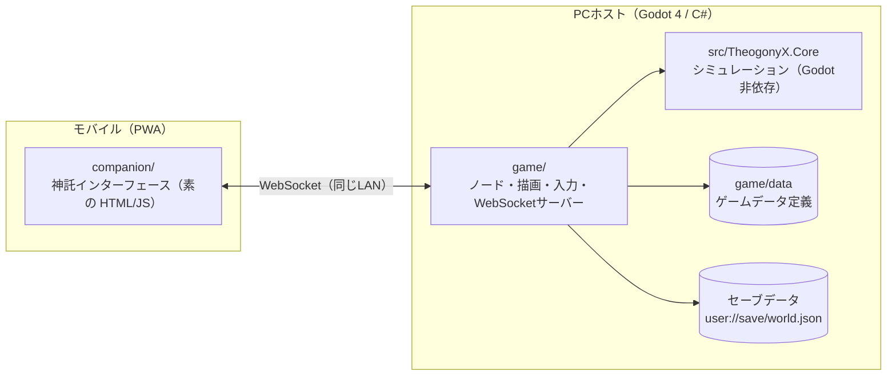
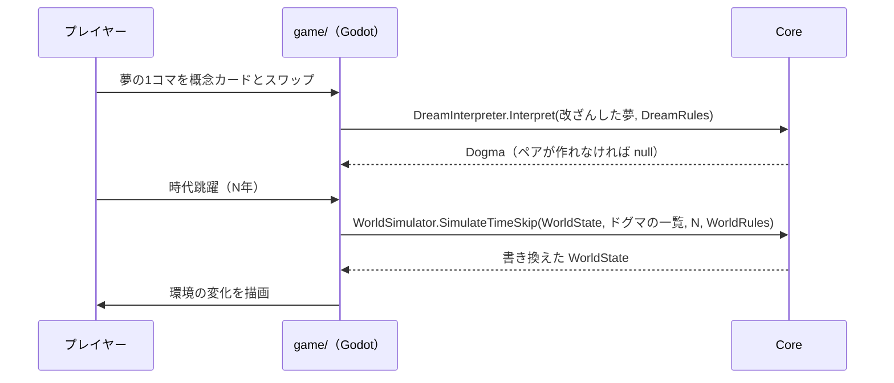

# アーキテクチャ概要

システムの今の姿を書く。常に最新に書き換え、各項目から根拠のADRへリンクする。経緯はADRに任せ、ここには書かない。

> 現在あるのは、コアループ（夢の解釈・時代跳躍）、地表の判定と時間の進め方（`TimeControl`）、それを描く Godot のメインシーン（`game/scenes/main/`。仮の単色タイル・HUD・操作ボタン・昼夜の環境光・予言者）、予言者の依頼と神託（コアの `ProphetDreams`、画面の `DreamView`。PC の画面とスマホから、手札のルーンを 2 枚選んで神託を下す。神威を使い、短い間に重ねると歪みが起きる。操作はすべてコアの `OracleCommandQueue` に命令として積み、積んだ順に実行する。使えるカードはコアの `OracleDeck`（山札・手札・捨札。[仕様書](domain/oracle-deck.md)）の手札だけ。[仕様書](domain/multiplayer.md)）である。コンパニオンとの通信（`CompanionHost`。HTTP で HTML/JS を配り、WebSocket でペアリング・画面の配信・夢の状態の送信と改ざんの受け付けを行う）と、コンパニオンの画面（`companion/`。映像・依頼の吹き出し・夢のカードの欄）もある。セーブ・ロード（コアの `Persistence/` が形と検証、`SaveStore` が `user://save/world.json` の読み書き。[仕様書](domain/save-data.md)）もある。住人（コアの `ResidentSimulator` が 1 年ごとに欲求・体力・SAN 値・精神崩壊・死を計算し、`TimeControl` が文明の計算の後に呼ぶ。`ResidentView` が仮の人形と墓を描く。[仕様書](domain/agent-needs.md)）もある。星の年表（コアの `History` を `TimeControl` が持ち、ドグマ・住人の出来事・崩壊・再創生と、100 年ごとの章の終わりを積む。`HistoryView` が HUD の欄に出し、行の文は `ChronicleText` が組み立てる。[仕様書](domain/history.md)）もある。予言者の誤解（コアの `OracleProphecy` が LLM への頼みの文を組み立てて応答を検証し、Godot 側の `OracleView` がローカルの Ollama に頼んで吹き出しに出し、年表に添える。Ollama への通信は `OllamaClient` が受け持つ。[仕様書](domain/ai-presentation.md)）もある。歴史の神話化（コアの `MythChronicle` が章の神話の頼みの文を組み立てて応答を検証し、Godot 側の `MythView` が `OllamaClient` で頼んで年表の章の行に添える。応答の検証の共通部分は `AiText`。[仕様書](domain/ai-presentation.md)）もある。群衆（`GpuCrowd` が Compute Shader の `crowd_step.glsl` で計算して読み戻し、使えなければコアの `Crowd` が CPU で計算する。`PotentialField` は地表から作る力の場。`CrowdView` が `MultiMeshInstance2D` で点を描く。見た目だけ。乱数は [ADR 0004](adr/0004-crowd-counter-based-hash-random.md)。[仕様書](domain/crowd.md)）もある。開発用に、起動の引数 `-- --crowd-bench`（計測）・`-- --crowd-check`（GPU 版と CPU 版の突き合わせ）で、`WorldCore` がゲームの代わりに `game/scenes/bench/` のノードを動かす。

## 全体構成

## 主な処理の流れ

## 主な設計方針
| 方針 | 根拠 |
| :--- | :--- |
| シミュレーションを Godot 非依存の C# ライブラリに分け、xUnit でテストする | [ADR 0001](adr/0001-separate-core-library.md) |
| Godot プロジェクトを `game/` に置き、コアを `ProjectReference` で参照する | [ADR 0002](adr/0002-godot-project-in-game-dir.md) |
| 調整値はコードに書かず、ゲームデータ定義に置く | 未記録 |
| コンパニオンは同じLANの WebSocket でホストに接続する | 未記録 |
| 画面の配信は WebSocket のバイナリフレームで送り、先頭 2 バイトに種別とバージョンを置く | [ADR 0003](adr/0003-binary-frame-header.md) |

## 共通部品
新しく作る前に、ここにあるものを使う。共通部品を追加したら、この表にも追加する。

| 種類 | 置き場所 | 例 |
| :--- | :--- | :--- |
| UIのテーマ | `game/ui/theme/` | 色・余白・フォント（`main_theme.tres` を `project.godot` の `gui/theme/custom` に設定済み） |
| 翻訳ファイル | `game/locales/ui.csv` | 画面の文言（`ja`・`en`） |
| UIの共通シーン | `game/ui/common/` | （まだ無い） |

## ディレクトリと責務
| ディレクトリ | 責務 |
| :--- | :--- |
| `src/TheogonyX.Core/` | モデル・夢の解釈・ドグマ・時代跳躍・セーブ形式・通信メッセージの型。Godot に依存しない |
| `tests/TheogonyX.Core.Tests/` | コアの自動テスト（xUnit） |
| `game/` | Godot プロジェクト（`project.godot`）。シーン・描画・入力・ファイル入出力・WebSocket サーバー |
| `game/data/` | ゲームデータ定義（`symbols.json`・`rules.json`）と、設定（`companion.json`・`save.json`）と、それをコアの定義（`DreamRules`・`WorldRules`・`TerrainRules`・`AmbienceRules` など）に変換する `GameDataLoader` |
| `game/scenes/` | シーンとそのスクリプト（シーンごとにディレクトリを分ける） |
| `game/locales/` | 翻訳ファイル |
| `companion/` | モバイルのコンパニオン（素の HTML/JS） |
| `docs/protocol/` | ホストとコンパニオンの通信の契約 |
