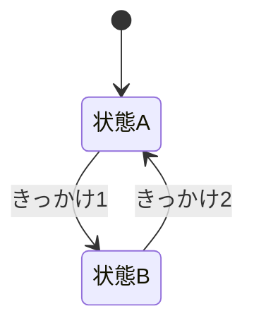

# 仕様書: <機能名>

- テスト仕様書: [docs/test/<機能名>.md](../test/<機能名>.md)
- 関連ADR: なし
- 通信: <docs/protocol/messages.md の該当メッセージ。無ければ「なし」>
- 画面デザイン: <ラフ・モックの置き場所。無ければ「なし」>

## 目的

誰の、何を解決する機能か。

## ゲームのルール

用語は [用語集](glossary.md) に合わせる。

- 

### 状態遷移
<!-- 状態を持つ機能なら必ず書く。無ければ節ごと削除する。すべてのマスを埋め、遷移できない組み合わせは「不可」と書く -->

| 現在の状態 ＼ きっかけ | きっかけ1 | きっかけ2 |
| :--- | :--- | :--- |
| 状態A | 状態B | 不可 |
| 状態B | 不可 | 状態A |

<!-- 任意: 全体を見渡すための図。書く場合は上の表と一致させる -->

## 受け入れ条件

| ID | Given（前提） | When（操作） | Then（結果） |
| :--- | :--- | :--- | :--- |
| AC-<機能名>-001 | | | |

## 対象外

この機能ではやらないと決めたことと、その理由。

## 未決

決まっていないこと。`as-is` の場合は、意図か不具合か判断できなかった挙動もここに書く。
