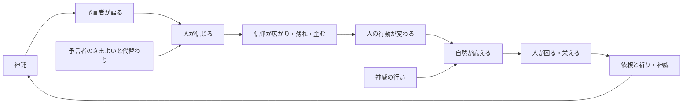

# 仕様書: コアループ（神託が人を通して星を変える）

- テスト仕様書: なし（ループの各部分は、それぞれの仕様書のテストで確かめる）
- 関連ADR: 決まったら作る（ゲームの軸が変わるため）
- 通信: なし（各部分の仕様書で決める）
- 画面デザイン: なし
- 出典: 2026-10-14 のチャット。ドグマを人の信仰にした（[信仰としてのドグマ](dogma-belief.md)）のに合わせて、コアループを考え直した
- 関連: [信仰としてのドグマ](dogma-belief.md)・[神託の作り方](oracle-pair.md)・[神託のデッキ](oracle-deck.md)・[予言者の依頼](prophet-request.md)・[時間の操作](time-control.md)・[星の年表](history.md)・[地域の環境](regional-environment.md)・[気候と天候](weather.md)・[住人による森と水の利用](resource-use.md)・[ロードマップ](../roadmap.md)の構想「神の直接の介入（奇跡）」

## 目的

プレイヤー（神）が何をし、その結果がどう星に返ってきて、次に何をしたくなるか、の一巡りを決める。各部分の仕様書は、この一巡りに沿って作る。

## ゲームのルール

用語は [用語集](glossary.md) に合わせる。

### 今のコアループ（2026-10-14 時点）
- 夢の改ざん（今は 2 枚のルーンで神託を作る）→ ドグマ生成 → 時代跳躍 → 環境変化。
- 神託がそのまま環境を変える 1 本道。`project.md` 1 章にもこの形で書かれている。

### 新しいコアループ（2026-10-14 に決定）
1. **神託**: プレイヤーが手札のルーン 2 枚で神託を作る（[神託の作り方](oracle-pair.md)）。
2. **予言者が語る**: 予言者が神託を誤解して伝える（[AI による表現](ai-presentation.md)）。
3. **人が信じる**: 予言者のいる地域の住人が、ドグマを信じ始める。
4. **信仰が広がり、薄れ、歪む**: 人から人へ、親から子へ（[信仰としてのドグマ](dogma-belief.md)）。
5. **人の行動が変わる**: 信じたドグマに従って、木を切らない・水場へ移る・森を焼く、など。
6. **自然が応える**: 森・水・気温・天候が、現実に寄せた式で動く（[地域の環境](regional-environment.md)・[気候と天候](weather.md)・[住人による森と水の利用](resource-use.md)）。
7. **人が困る・栄える**: 飢饉・移住・繁栄・滅び。
8. **祈りが返る**: 予言者が困りごとを依頼し（[予言者の依頼](prophet-request.md)）、信者の祈りで神威が溜まる。
9. 次の神託へ。

- 神託から結果まで、何年もかかる。間に人が挟まるので、プレイヤーの思いどおりにはならない。

### プレイヤーの目的（2026-10-14 に決定）
- **目的を持たない箱庭**にする。勝ち負け・お題は無い。プレイヤーは眺めて楽しみ、起きたことは歴史として残る（[星の年表](history.md)、構想「歴史の全書と博物館」）。
- 星の崩壊も「負け」ではなく、歴史の一つの終わり方とする（世界再創生で次の周回へ。[地層](strata.md)）。

### プレイヤーが選べるもの（2026-10-14 に決定）
- **何を**: 手札のどのルーン 2 枚で神託を作るか（今のまま）。
- **いつ**: いつ神託を下すか（今のまま）。
- **どこで**: 選べない（2026-10-14 に決め直した）。予言者は自分でさまよい、神託はそのとき予言者のいる地域から広がる（[予言者の暮らし](prophet-life.md)）。最初は「予言者の居場所を選ぶ」と決めたが、予言者を自分の足で動く一人の人にしたので外した。
- **神威の行い**: 溜まった神威を使って、神が直接手を下す（奇跡）。ドグマは人を通してしか効かないので、自然を直接動かせるのはこれだけ（構想「神の直接の介入」。中身は未決）。手札を引くのにも神威を使う（今のまま）ので、引くか行うかを選ぶことになる。

### 時間の流れ（2026-10-14 に決定）
- **自動進行を主にする**。年は自動で進み、予言者の依頼が出たときに止まる（今の仕組みの延長。[時間の操作](time-control.md)・[予言者の依頼](prophet-request.md)）。
- 時代跳躍（ボタンで決まった年数を進める）は残す。

### 神託が効いたと分かる手がかり（2026-10-14 に決定）
- **信者の数**: HUD の一覧に、信者のいるドグマと信者の数を出す。増える・減る・消えるのが見える（[信仰としてのドグマ](dogma-belief.md)）。
- **年表**: 「〇〇の教えが地域 3 に広がった」「〇〇の教えが忘れられた」「木の禁忌で森が戻った」のような出来事を年表に残す（[星の年表](history.md)）。
- 予言者の依頼が済むことも手がかりになる（今のまま）。

## 受け入れ条件

ループの各部分の仕様書に置く。この仕様書には置かない。

## 対象外

- 勝ち負け・周回ごとのお題（2026-10-14 に、目的を持たない箱庭と決めた）。

## 未決

- **神威の行い（奇跡）の中身**: 何ができるか（雨を呼ぶ・雷・豊作など）、神威をいくつ使うか、どこに効くか（予言者の地域か、選んだ地域か）、手札を引くこととの取り合い。構想「神の直接の介入」から仕様書にする。
- **年表に残す信仰の出来事**: どの出来事を、どのくらいの頻度で残すか（多すぎると読めない）。
- **`project.md` の書き換え**: 1 章のコアループ「夢の改ざん → ドグマ生成 → 時代跳躍 → 環境変化」を、新しい形に書き換えるか。ルールのファイルは人間が直す（AI は書き換えない）。書き換えの案: 「神託 → 人が信じる → 信仰が広がる → 人の行動が変わる → 自然が応える → 依頼と祈り」。「夢の改ざん」は、神託の作り方を変えたときに廃止した用語（[用語集](glossary.md)）。
