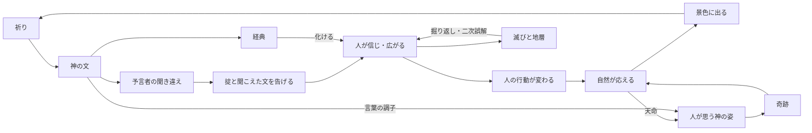

# 仕様書: コアループ（神託が人を通して星を変える）

- テスト仕様書: なし（ループの各部分は、それぞれの仕様書のテストで確かめる）
- 関連ADR: 決まったら作る（ゲームの軸が変わるため）
- 通信: なし（各部分の仕様書で決める）
- 画面デザイン: なし
- 出典: 2026-10-14 のチャット。ドグマを人の信仰にした（[信仰としてのドグマ](dogma-belief.md)）のに合わせて、コアループを考え直した
- 関連: [信仰としてのドグマ](dogma-belief.md)・[神託の作り方](oracle-pair.md)・[神託のデッキ](oracle-deck.md)・[予言者の依頼](prophet-request.md)・[時間の操作](time-control.md)・[星の年表](history.md)・[地域の環境](regional-environment.md)・[気候と天候](weather.md)・[住人による森と水の利用](resource-use.md)・[ロードマップ](../roadmap.md)の構想「神の直接の介入（奇跡）」

## 目的

プレイヤー（神）が何をし、その結果がどう星に返ってきて、次に何をしたくなるか、の一巡りを決める。各部分の仕様書は、この一巡りに沿って作る。

## ゲームのルール

用語は [用語集](glossary.md) に合わせる。

### 今のコアループ（2026-10-14 時点）
- 夢の改ざん（今は 2 枚のルーンで神託を作る）→ ドグマ生成 → 時代跳躍 → 環境変化。
- 神託がそのまま環境を変える 1 本道。`project.md` 1 章にもこの形で書かれている。

### 新しいコアループ（2026-10-14 に決定。2026-10-16 に神託の形を書き直した）
2026-10-16 に、神託を「手札のルーン 2 枚を選ぶ」から「文で語り、予言者が方言のように聞き違える」に替えた（[神託の作り方](oracle-pair.md)の「自由文の神託」）。ゲームの独自性の柱（人が思う神の姿・天命・感情の見える化・経典の化け方）もここに入れた。

**短い輪（数十年）**
1. **祈り**: 予言者が困りごとを祈る（[予言者の依頼](prophet-request.md)）。予言者は知っている言葉だけで祈るので、祈りは予言者の語彙（手札。画面に出さない）を推し量る手がかりになる。
2. **神の答え**: プレイヤーは、文で語る（神託）か、奇跡を落とす（[奇跡](miracle.md)）。神託は祈りが無くてもいつでも語れ、連発は神威の代償で抑える。
3. **聞き違え**: 予言者は神の言葉を自分の言葉で聞き直す。知らない言葉は近い知っている言葉に、知っている言葉も語義のずれ表に従ってずれる。ずれの大きさは予言者の器（LLM のモデルと頼み方）でも変わる（[AI による表現](ai-presentation.md)）。
4. **告げる**: 予言者は「〈木〉に触れるな」のような掟の 1 行と、聞こえた文を民に告げる。教えは 1 つ（記号 × 種別 × 強度）。神の文はそのまま経典として残る。言葉の調子は、人が思う神の姿を動かす（[神々](gods.md)）。
5. **人が信じ、広がる**: 予言者の地域から、出会いと司祭の網で信者が広がり、薄れ、歪む（[信仰としてのドグマ](dogma-belief.md)）。
6. **人の行動が変わる**: 教えの行動の表に従って、木を切らない・水場へ移る・森を焼く、など。
7. **自然が応える**: 森・水・気温・天候が、現実に寄せた式で動く（[地域の環境](regional-environment.md)・[気候と天候](weather.md)）。神のしていない災いも、人は神の意思と読み、神の姿がずれる（天命）。神の姿は、使える奇跡と効き方を決める。
8. **景色に出る**: 人の困り方・栄え方は、数値でなく、街の形・土地の跡・群衆の動きに出る（[感情の見える化](emotion-visuals.md)）。
9. **祈りと語彙が返る**: 困りごとが次の祈りになり、信者の祈りで神威が溜まる。歴史の出来事でルーンが手札に入り、予言者の語彙が増える（[神託のデッキ](oracle-deck.md)）。プレイヤーは神託を重ねて、予言者の方言を覚えていく。

**長い輪（数百〜数千年）**
10. **経典が化ける**: 経典は語り継がれるうちに少しずつ書き換わり、化けた経典から人が唱える教えと宗派が生まれる（[AI による表現](ai-presentation.md)の「経典」・[宗教](religion.md)）。
11. **滅びと地層**: 文明が崩壊すると、廃墟は沈み、滅びの理由が地層の色に残る（[崩壊](collapse.md)・[地層](strata.md)）。
12. **掘り返される**: 後の民が遺物を掘り当て、ずれた言葉で読み違えて新しい教えにする（二次誤解）。プレイヤーは、昔の自分の言葉がどう化けたかを年表で読む。

- 神託から結果まで、何年もかかる。間に予言者の耳と人が挟まるので、プレイヤーの思いどおりにはならない。

### 誤解の納得感（2026-10-16 に決定）
- 方針: **誤解には、後から読める理由がある**。プレイヤーが振り返って「だからか」と分かり、次は避けられるようにする。理由の無いでたらめな誤解にしない。
- これを守る決まり:
  - 聞き違えは、方言帳に理由つきで残る（「守る → 囲う（この予言者の言葉）」「若木 → 木（知らない言葉）」。[神託の作り方](oracle-pair.md)）。
  - 同じ予言者・同じ言葉は、同じように聞き違える（ずれ表はシードで決まる表で、LLM は表に従うだけ）。
  - 覚えたことは無駄にならない（ずれ表が変わるのは言葉が分かれたときだけ）。
  - 1 回の神託でずれるのは 1 か所まで。
  - 同じ教えは同じ行動になる（行動の表。[信仰としてのドグマ](dogma-belief.md)）。
- 新しい仕組みを足すときも、この方針に合うかを確かめる。

### プレイヤーの目的（2026-10-14 に決定）
- **目的を持たない箱庭**にする。勝ち負け・お題は無い。プレイヤーは眺めて楽しみ、起きたことは歴史として残る（[星の年表](history.md)、構想「歴史の全書と博物館」）。
- 星の崩壊も「負け」ではなく、歴史の一つの終わり方とする（世界再創生で次の周回へ。[地層](strata.md)）。2026-10-15 に、崩壊を「人が絶えたとき」にし、崩壊の後も自然は動き続け、何百年か後に新しい人が現れて歴史が続くと決めた（[星の崩壊と文明の崩壊](collapse.md)）。

### プレイヤーが選べるもの（2026-10-14 に決定。2026-10-16 に書き直した）
- **何を**: 神託の文（自由文）。何が伝わるかは、予言者の語彙と方言で決まる。2026-10-14 の「手札のどのルーン 2 枚で神託を作るか」は、自由文に替えた（LLM が使えないときだけ、今の 2 枚の組で下す。[神託の作り方](oracle-pair.md)）。
- **どう言うか**: 言葉の調子（諭すか、命じるか）。人が思う神の姿を動かす（[神々](gods.md)）。
- **いつ**: いつ神託を下すか（いつでも。神威の代償で連発を抑える）。
- **どこへ**: 予言者に行き先を告げられる（2026-10-17 に決め直した）。神託の文に行き先を書くと、予言者がそれを聞いて向かう。知らない土地の名は聞き違える。予言者を直接は動かせず、普段は予言者が理由を持って旅をする（[予言者の暮らし](prophet-life.md)）。2026-10-14 には「どこで」は選べないと決めていた。
- **神威の行い**: 信者の祈りで種類ごとに溜まる奇跡の力を使って、神が直接手を下す（[奇跡](miracle.md)）。信者のいる地域ならどこにでも落とせ、場所を選べる唯一の手になる。使える奇跡と効き方は、人が思う神の姿に従う（2026-10-16 に決定）。奇跡は神威を使わないので、神託とは取り合わない（2026-10-15 に決め直した）。

### 神の手の届き方（2026-10-15 に決め直した）
星が大きくなった（96 地域・数十億人・国。[人の数](population.md)）ので、神託 1 つの重みが小さくなりすぎないように決め直した。
- **神託は、司祭の網で信者の地域へ届く**: 神託は予言者の地域から始まり、神の宗派の司祭（[宗教](religion.md)）が道の網（[運送と物流](logistics.md)）で、信者のいる地域へ伝える。遠いほど遅く届き、歪みやすい。信者が広くいるほど、神託が星に効く。信者のいない地域へは、今までどおり人づてに広がる（[信仰としてのドグマ](dogma-belief.md)）。現実の、教えが司祭や教会の網で遠くへ届き、途中で解釈がずれる形に寄せた。
- **新しい神託は、同じ宗派の教えに加わる**: 同じ予言者（とその後継ぎ）の神託は、神の宗派の教えの一覧に加わる（クルアーンが 23 年かけて 1 つの教えにまとまったように）。すでに信じている人は、新しい教えも受け入れやすい。宗派が分かれるのは、歪み・後継ぎ争い（[予言者の暮らし](prophet-life.md)）・神の沈黙の後の新しい予言者のとき。
- **予言者は 1 人のまま**: 神の声を聞くのは予言者 1 人。届き方は司祭の網で広げる。予言者の重みと物語を保つ。
- 「どこで」が選べないことは変わらない。

### 時間の流れ（2026-10-14 に決定）
- **自動進行を主にする**。年は自動で進み、予言者の依頼が出たときに止まる（今の仕組みの延長。[時間の操作](time-control.md)・[予言者の依頼](prophet-request.md)）。
- 時代跳躍（ボタンで決まった年数を進める）は残す。

### 神託が効いたと分かる手がかり（2026-10-14 に決定。2026-10-16 に書き直した）
- **告げる言葉**: 神託の直後に、予言者が掟の 1 行と聞こえた文を告げる。自分の言葉がどう聞き違えられたかが、その場で分かる（[神託の作り方](oracle-pair.md)）。
- **景色**: 信仰と困り方が、街の形・土地の跡・群衆の動きに出る（[感情の見える化](emotion-visuals.md)）。感情の値は数で出さない。
- **年表**: 「〇〇の教えが地域 3 に広がった」「〇〇の教えが忘れられた」「木の禁忌で森が戻った」のような出来事と、化けていく経典を年表に残す（[星の年表](history.md)）。
- **信者の数**: 2026-10-14 に、HUD の一覧に信者のいるドグマと信者の数を出すと決めた。2026-10-17 に、信者の人数は感情の値ではないので残すと決めた（[感情の見える化](emotion-visuals.md)）。
- 予言者の依頼が済むことも手がかりになる（今のまま）。

### 遊びの流れの例（2026-10-16 時点の決定で書いた例）
決まりではなく、決まったことを並べて遊びを想像するための例。数値は仮。【未決】は決まっていないところ。

1. **年 0**: 島の多い星に、数十の群れと予言者が 1 人。予言者の語彙（手札）は木・聖なる火・鉄・大地の 4 つで、プレイヤーには見えない。恵みの雨は山札にある。別の大陸に NPC の神が 1 柱眠る。
2. **年 180 祈り**: 森を拓きすぎて森林量が 30 を切り、民が飢える。予言者が祈る（「神よ、木は痩せ、火も細り、子らは飢えております」）。祈りには知っている言葉だけが出るので、雨の言葉は無い。自動進行が止まる。
3. **答え**: 奇跡（恵みで食料を足す。溜まった力を使う）か、神託。プレイヤーは「雨は通じないかも」と考えて書く: 「森を守れ。若木を切るな。冬を越すまで耐えよ」。諭す調子なので、人が思う神の姿は慈悲の側へ少し動く。
4. **予言者が告げる**: 予言者は神の言葉を自分の言葉で聞き直す。この予言者の語義のずれ表では「守る」が「囲う」に聞こえ、「若木」は知らない言葉なので「木」に聞き違える。予言者は「森を囲い、木に斧を入れるな」と聞こえた文を告げ、教えは〈木〉の禁忌 1 つになる。吹き出しの頭に「〈木〉に触れるな」、下に聞こえた文と語り。答えは命令の列に、神の文は経典として年表に残る。プレイヤーは「この予言者には『守る』が『囲う』に聞こえる」と方言を 1 つ覚える。
5. **年 180〜300 教えが広がる**: 信者が出会いと信仰の差で広がり、木を切らなくなって森が戻る。薪と畑が足りず、しばらく飢えは続く。景色が変わる（傾いた家・増える墓・祠を回る群衆）。数値は出ない。
6. **年 240 天命**: 神のしていない干ばつを、民は「斧を入れた者への罰」と読み、神の姿は怒りの側へずれる。罰の奇跡が効きやすく、恵みが効きにくくなる。
7. **年 300 語彙が変わる**: 歴史の出来事でルーンが手札に入り、予言者の語彙が増える【どの出来事でどのルーンかは [神託のデッキ](oracle-deck.md)】。
8. **年 600 経典が化ける**: LLM が経典を少しずつ書き換え「神は森を愛し、斧を持つ者を憎む」になる。ある宗派が「木こりを罰せよ」と唱え、宗派が分かれ、不穏から戦になる。
9. **年 900 滅び**: 人口が 20 年で半分になり崩壊。廃墟が沈み、地層に「戦」の赤黒い焼土の層が残る。経典の石も遺物として埋まる。
10. **年 1500 掘り返される**: 新しい民が井戸を掘って遺物を当てる。言葉が大きくずれていて「斧を持つ者を憎む」が「鉄を持つ者が神に選ばれる」と読み違えられ（二次誤解）、鉄を崇める教えが広まる。プレイヤーは、自分の「若木を切るな」がこう化けたことを年表で読む。

例を書いて見えた穴（未決に足した）: 最初の祈りまでの間にすることが無い、同じ祈りに奇跡と神託の両方を使えるか、結果が出るまで何十年もかかる手応えの遅さ、NPC の神と出会うまでの長さ。

## 受け入れ条件

ループの各部分の仕様書に置く。この仕様書には置かない。

## 対象外

- 勝ち負け・周回ごとのお題（2026-10-14 に、目的を持たない箱庭と決めた）。

## 未決

- **遊びの流れの例で見えた穴（2026-10-16）**: 最初の祈りはいつ来るか（神託はいつでも下せると 2026-10-16 に決め直したので、祈りの前にも語りかけられる。祈りの前は語彙の手がかりが少ない）。同じ祈りに奇跡と神託の両方を使えるか。結果が何十年も先に出る手応えの遅さを、時間の速さ（[時間の速さ](time-scale.md)）で補えるか。NPC の神と出会うまでの長さ。
- **年表に残す信仰の出来事**: どの出来事を、どのくらいの頻度で残すか（多すぎると読めない）。
