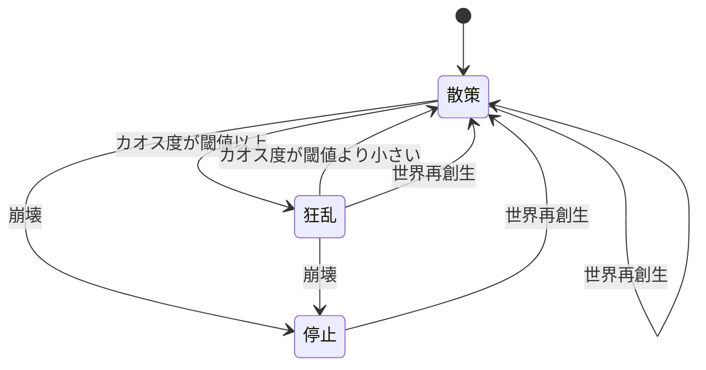

# 仕様書: 群衆（大量 NPC）

- テスト仕様書: [docs/test/crowd.md](../test/crowd.md)
- 関連ADR: [0004 群衆の乱数](../adr/0004-crowd-counter-based-hash-random.md)
- 通信: なし
- 画面デザイン: なし。アセットと画面の規格は [docs/art-guide.md](../art-guide.md)
- 出典: 2026-10-12 のチャットでの確定仕様（ロードマップ M3「GPU による大量 NPC・環境の並列計算」）

## 目的

1人だった予言者の周りに、数の多い人間（群衆）を置き、星の状態が人々の動きにも表れるようにする。カオス度が高まると群衆が一斉に聖地へ押し寄せ、ドグマが暴走していることを画面で見て分かるようにする。

## ゲームのルール

用語は [用語集](glossary.md) に合わせる。群衆は見た目だけで、シミュレーションの結果（環境の値・ドグマ・夢）には影響しない。コアの状態を読んで動くだけで、書き戻さない。

### 人数と見た目

- 群衆は 10,000 人である。人数はゲームデータ定義（`game/data/rules.json` の `crowd`）に置く。
- 1 人を 1〜2 px の点で描く。点の大きさと色は `rules.json` の `crowd` に置く。
- 群衆は地表（16 × 9 タイル、256 × 144 px）の範囲の中にいて、外に出ない。
- 昼夜の環境光は、地表・予言者と同じく群衆にもかかる。

### 時間

- 群衆は、自動進行中だけ動く。止まっている間（一時停止中・起動直後の止まった状態）は、その場で止まって見える（2026-10-12 に確定）。
- 自動進行の速さが高速のときは、群衆の時間も速く進む（歩く・押し寄せるのが速くなる）。倍率は `rules.json` の `crowd` に置く。通常と現実同期では、実際の時間と同じ速さで進む（2026-10-12 に確定）。
- 100 年跳躍では、群衆は動かない（跳躍は一瞬で終わる）。
- 同じシード・同じ経過時間・同じ星の状態の移り変わりからは、同じ配置になる（決定性。乱数はシードから作る）。

### 始めの配置

- 群衆は、地表の範囲の中にばらばらに置く。配置はシミュレーションのシードから決まる。
- 群衆の位置はセーブに残さない。ゲームを読み込んだときは、始めの配置から動き出す。

### 動きの状態

群衆の全員が、星の状態から決まる次の 3 つのどれかで動く。状態は群衆の全員で共通である。

| 状態 | 条件 | 動き |
| :--- | :--- | :--- |
| 散策 | 星が崩壊しておらず、カオス度が狂乱の閾値より小さい | ときどき向きを変えながらゆっくり歩き、その歩みにポテンシャルフィールドの力を足す（下の節）。地表の端に来たら跳ね返る |
| 狂乱 | 星が崩壊しておらず、カオス度が狂乱の閾値以上 | 聖地へ向かって、散策より速く進む。タイルの力は受けない。聖地の周りに着いたら、そこに留まる |
| 停止 | 星が崩壊している | その場で止まる |

- 狂乱の閾値はカオス度 50 である。値は `rules.json` の `crowd` に置く。
- 聖地は予言者の立つ場所（予言者の足元。地表の上端で、予言者の絵の左右の中央）である。
- 歩く速さ、向きを変える間隔、狂乱の速さ、聖地の周りに留まる範囲は `rules.json` の `crowd` に置く。

### ポテンシャルフィールド（散策のときの力）

- 地表のマスごとのタイル種別（[planet-display.md](planet-display.md)。水場を含む）から、人を引き寄せる力・遠ざける力の場を作る。
  - 引き寄せる: 水場・草地・密林
  - 遠ざける: 砂漠・氷河・焦土（焦土が一番強い）
- 種別ごとの力の強さは `rules.json` の `crowd` に置く。
- 人が受ける力は、周りの 4 マスの中心の力を位置に応じて混ぜたもの（双線形補間）にする。マスの中でどこでも同じ力にすると、向きが逆のマスの境目に人が溜まって線に見えた（2026-10-12）。
- タイルが変わったら（年が進む・神託・跳躍・世界再創生の後）、力の場を作り直す。
- 群衆は、緑地・水場へ移り住み、砂漠・焦土・氷河から逃げていくように見える。

### 群れの動き（試し）

2026-10-12 に試しに足した（人間の依頼）。`rules.json` の `crowd.flock.enabled` で使うかを切り替える。値はすべて仮置き。

- 散策のときだけ、歩みに群れの力を足す（Boids の簡略版）。狂乱・停止では使わない。
- 地表を細かいマス（`cellSize`）に分け、歩を始めたときの全員の位置と向きから、マスごとの人数・重心・向きの和を集計する。
- 各人は、自分のマスを中心とした 3 × 3 のマス（自分を含む）の集計を見る。
  - 周りの平均の向きに寄せる（`alignWeight`）。
  - 周りの人数が目標（`targetNeighbors`）より少なければ重心に近づき、多ければ離れる（`crowdWeight`）。人数が目標の 2 倍以上なら、離れる力は最大になる。
- 周りに自分しかいなければ、群れの力はかからない。

### 状態遷移

きっかけは、年が進む・神託・世界再創生などで星の状態が変わったことである。変わった後の状態で、上の表の条件を判定し直す。

| 現在の状態 ＼ きっかけ | カオス度が閾値より小さくなった（崩壊していない） | カオス度が閾値以上になった（崩壊していない） | 星が崩壊した | 世界再創生 |
| :--- | :--- | :--- | :--- | :--- |
| 散策 | 散策（そのまま） | 狂乱 | 停止 | 散策（始めの配置に戻す） |
| 狂乱 | 散策（今いる場所から歩き出す） | 狂乱（そのまま） | 停止 | 散策（始めの配置に戻す） |
| 停止 | 不可（崩壊中は環境の値が変わらない） | 不可（崩壊中は環境の値が変わらない） | 停止（そのまま） | 散策（始めの配置に戻す） |

- 世界再創生の後は、初期値のカオス度で判定し直す。初期値が閾値以上なら、続けて狂乱に移る。

### 計算の場所

- 群衆の計算は GPU（Compute Shader）でも行えるようにする。同じ計算の CPU 版をコアに持ち、結果を突き合わせる（`.agent/rules/godot.md`）。
- GPU 版と CPU 版の結果は、浮動小数点の誤差の範囲で一致すればよい。群衆は見た目だけなので、機種による小さな差は許す。
- 長く動かすと、小さな差が地表の端やマスの境目での分岐（跳ね返るか、どのマスの力を受けるか）を変え、人によっては差が 1 タイルほどに広がる。計算の誤りではないので、突き合わせは「同じ状態から 1 歩を進めた結果」で行う（2026-10-12 の計測で判明。群れの動きでは、集計のマスの境目でも 8 歩で 0.01 タイルほどずれた）。
- GPU が使えない環境（headless、Compatibility の描画方式など）では CPU 版で計算する。

## 受け入れ条件

| ID | Given（前提） | When（操作） | Then（結果） |
| :--- | :--- | :--- | :--- |
| AC-crowd-001 | 同じシード | 始めの配置を 2 回作る | 2 回とも全員の位置が同じ |
| AC-crowd-002 | 任意のシード | 始めの配置を作る | 人数が `crowd` の人数（10,000）で、全員が地表の範囲（タイルの単位で 0 ≦ x ≦ 16、0 ≦ y ≦ 9。1 タイル = 16 px）の中にいる |
| AC-crowd-003 | カオス度 49.9、崩壊していない | 群衆の状態を求める | 散策 |
| AC-crowd-004 | カオス度 50、崩壊していない | 群衆の状態を求める | 狂乱 |
| AC-crowd-005 | カオス度 80、崩壊している | 群衆の状態を求める | 停止 |
| AC-crowd-006 | 散策の状態 | 長い時間（例: 60 秒）動かす | 全員が地表の範囲の中にいる |
| AC-crowd-016 | 散策の状態で、地表の左半分が焦土、右半分が草地 | 十分な時間動かす | 右半分にいる人の数が、始めより増える |
| AC-crowd-018 | 自動進行していない（止まっている） | 群衆の時間の進み方を求める | 0（動かない） |
| AC-crowd-019 | 自動進行中、速さが通常または現実同期 | 群衆の時間の進み方を求める | 1（実際の時間と同じ） |
| AC-crowd-021 | CPU 版を状態の移り変わり（散策・狂乱・停止・世界再創生）に沿って動かす | 途中の各時点の CPU 版の状態から、GPU 版でも同じ 1 歩を進める | 全員の位置の差が 0.001 タイル以内 |
| AC-crowd-022 | 群れの動きを使う、散策 | 長い時間（例: 60 秒）動かす | 全員が地表の範囲の中にいる |
| AC-crowd-023 | 群れの動きを使う、同じシード・同じ状態の移り変わり | 同じ時間だけ動かす | 2 つの群衆の全員の位置が同じ。群れの動きを使わないときとは位置が変わる |
| AC-crowd-024 | 地表 16 × 9、マス 0.5。マス (0, 0) の中心に向き 0 の人、マス (1, 1) の中心に向き 90° の人、3 × 3 の外に 1 人 | マス (0, 0) の周りの集計を求める | 人数 2、重心 (0.5, 0.5)、平均の向き (0.5, 0.5)（誤差 1/1024 以内） |
| AC-crowd-020 | 自動進行中、速さが高速 | 群衆の時間の進み方を求める | `crowd` の高速のときの倍率 |
| AC-crowd-017 | 狂乱の状態で、地表の一部が焦土 | 動かす | 焦土の有無で動きが変わらない（聖地の引力だけを受ける） |
| AC-crowd-007 | 同じシードの群衆が 2 つ、同じ状態の移り変わり | 同じ時間だけ動かす | 2 つの群衆の全員の位置が同じ |
| AC-crowd-008 | 狂乱の状態 | 動かす | 聖地の周りの範囲の外にいる人は、聖地との距離が縮む |
| AC-crowd-009 | 狂乱の状態で十分な時間が経った | 動かす | 全員が聖地の周りの範囲の中に留まる |
| AC-crowd-010 | 停止の状態 | 動かす | 全員の位置が変わらない |
| AC-crowd-011 | 星が崩壊している | 世界再創生をする | 群衆が始めの配置に戻り、散策で動き出す |
| AC-crowd-012 | 廃止（長く動かすと差が分岐で広がるため、AC-crowd-021 に置き換えた） | | |
| AC-crowd-013 | メインシーンを実行した | 画面を見る | 地表の上を点の群衆がばらばらに歩き回る。環境光が群衆にもかかる。HUD の上には描かれない |
| AC-crowd-014 | 夢の改ざんでカオス度を 50 以上にした | 画面を見る | 群衆が一斉に予言者の足元へ押し寄せ、周りに留まる |
| AC-crowd-015 | 群衆を表示している | 計測用のシーンで動かす | 10,000 人で 60fps を保つ（[nfr.md](../nfr.md) の目標。推奨スペックの PC） |

## 対象外

- 群衆がシミュレーションの結果に影響すること（ドグマの感染、人口など）: 決定性を保つため、群衆は見た目だけにした（2026-10-12 に確定）。
- 群衆どうしの衝突回避（人と人の正確な距離による押し合い）・経路探索: 群れの動きは、マスごとの集計による簡略版にした。
- 欲求ベースの行動・世代交代・自律建築: ロードマップの M4 の構想にした（2026-10-12）。
- 人の形のドット絵・多種族・狂乱のアニメーション: 1〜2 px の点で描くと決めた（2026-10-12）。
- 群衆の位置のセーブ: 見た目だけなので残さない。
- 予言者以外の NPC の依頼（[prophet-request.md](prophet-request.md)）: 今回は扱わない。

## 未決

- 歩く速さ・向きを変える間隔・狂乱の速さ・聖地の周りに留まる範囲・タイル種別ごとの力の強さ・高速のときの倍率・点の大きさと色の値。
- 10,000 人の 1 px の点が地表の約 3 割を埋め、ノイズのように見える。人数・点の色を見直すか。仮の値を `rules.json` に置き、実際に見て決める。
- 群れの動きを残すか（試し）と、その値（マスの大きさ・寄せる強さ・目標の人数）。
- 用語集に「群衆」「散策」「狂乱」「聖地」を足すか。
- 推奨スペックの PC（[nfr.md](../nfr.md) の性能の目標が「例」のまま）。
