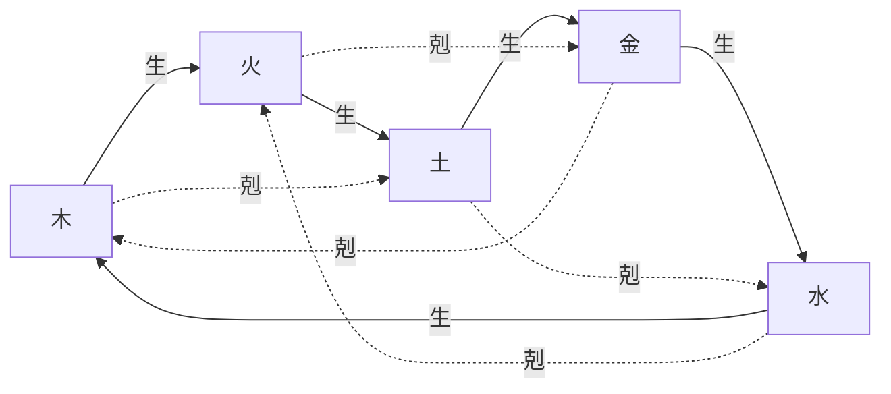

# 仕様書: 神託の五行（相生・相剋・比和）

- テスト仕様書: [docs/test/oracle-wuxing.md](../test/oracle-wuxing.md)（段階 1 の分）
- 関連ADR: なし
- 通信: [messages.md](../protocol/messages.md) の `ORACLE_STATE`（手札に新しいルーンの ID が入るだけで、形は変えない）
- 画面デザイン: なし
- 出典: 2026-10-14 のチャットでの決定（人間が「陰陽五行説で考え直したい」と言い、AI の見直し案の「おすすめどおり」を選んだ）。**値と名前のうち、人間が指定していないものは AI が仮に置いたもの（`TODO(AI_UNSURE)`）で、人間が決め直す。**
- 関連: [神託の作り方（ルーンの組）](oracle-pair.md)・[神託のデッキ](oracle-deck.md)・[時代跳躍](time-skip.md)（ドグマの効果）

## 目的

神託の「どうする」（崇拝・禁忌・破壊）を、記号の感情の極性の和という見えない数値ではなく、**選んだ 2 枚のルーンの五行の関係**で決める。プレイヤーが「木は火を生む」「水は火を剋す」という覚えやすい関係から結果を読めるようにし、デッキに入れるルーンの組み合わせを考える楽しさを作る。あわせて、記号を五行の 5 つ（木・火・土・金・水）にそろえ、融合を「同じ五行を 2 枚重ねて上位のルーンにする」形にする。

## 実装の進み方

旧い方式（極性の和）を一度に消さないため、段階に分ける。

| 段階 | 内容 | 状態 |
| :--- | :--- | :--- |
| 1. 記号を足す | 土・金の記号と、その効果（`dogmaEffects`）・重み・文言を、データ定義に足す。最初のデッキに入れる。種別の決め方は極性の和のまま | 実装済み（手動テストは未） |
| 2a. 追加 | 五行の判定をコアに足す。データ定義の `oracle.typeRule` で種別の決め方を選べるようにし、値は `Polarity`（旧い方式）のまま | 実装済み |
| 2b. 切り替え | `typeRule` を `Wuxing` にする。PC の案内に結果の予告を出し、種別の名前に陰陽を添える | 実装済み（手動テストは未） |
| 2c. 削除 | 旧い方式（極性の和・種別の閾値・`typeRule`）を消す。記号の感情の極性（`emotionalPolarity`）と種別の閾値（`dogmaTypeThresholds`）は、データ定義からも消した | 実装済み |
| 3. 融合 | 再創生の精査に、比和の融合（同じ五行 2 枚 → 上位のルーン 1 枚）を足す | 実装済み（手動テストは未） |

## 置き換えるもの

この仕様書が `approved` になったら、次を書き換える（黙って直さず、段階ごとに行う）。

| 仕様書 | 置き換える部分 |
| :--- | :--- |
| [神託の作り方（ルーンの組）](oracle-pair.md) | 「ドグマの種別は、2 枚の極性の和で決める」「衝撃度」「強度」の式（段階 2） |
| [神託のデッキ](oracle-deck.md) | 融合の例（水 ＋ 鉄 ＝ 潜水艇、複合ルーン）、AC-oracle-deck-009・014、最初のデッキの枚数（段階 1・3） |
| [用語集](glossary.md)・[用語の手引き](../terms-guide.md) | 五行・相生・相剋・比和・穢れ・上位のルーンを足す。記号の一覧を 5 つ＋血にする |

## ゲームのルール

用語は [用語集](glossary.md) に合わせる。

### 五行と記号

記号を、五行の 5 つにそろえる。今ある 3 つはそのまま使い、2 つを足す。水の記号の ID は、段階 1 の前に単独の変更で `SYM_RAIN` から `SYM_WATER` に変えた（2026-10-14 に決定。`saveVersion` 15）。

| 五行 | 記号の ID | 画面の名前 | 今あるか | 主に効く世界の値 |
| :--- | :--- | :--- | :--- | :--- |
| 木 | `SYM_TREE` | 木 | ある | 森林量 |
| 火 | `SYM_FIRE` | 聖なる火 | ある | 気温 |
| 土 | `SYM_EARTH` | 大地（仮） | **足す** | 調和度・森林量・水資源 |
| 金 | `SYM_METAL` | 鉄（仮） | **足す** | 気温・カオス度 |
| 水 | `SYM_WATER`（旧 `SYM_RAIN`） | 恵みの雨 | ある | 水資源 |

- 土・金の効き先は、今ある世界の値（森林量・水資源・気温・カオス度・調和度）だけにする（2026-10-14 に決定）。地域の技術・文化をドグマで動かすことは、後で広げる（[未決](#未決)）。
- 水は、システムの中では「水」として扱い、画面と予言者の語り（LLM）では「恵みの雨」「清らかな恵み」などの表現を残す（2026-10-14 に決定）。
- TODO(AI_UNSURE): 土・金の画面の名前（大地・鉄）。
- **人と知の記号を足す**（2026-10-16 に決定）: 奴隷解放と学問の教えを表すため、記号「人」と「知」を足す。五行の性は、儒教の五常（木＝仁・火＝礼・土＝信・金＝義・水＝智）に寄せて、人は木の性（仁）、知は水の性（智）とする。神託の種別を決める五行の関係（相生・相剋・比和）は、この性で今の決まりをそのまま使う。行動の表は[信仰としてのドグマ](dogma-belief.md)。記号の ID と画面の名前は未決（案: `SYM_HUMAN`・`SYM_KNOWLEDGE`）。

### 陰陽

- 画面（PC）: 手札の 2 枚を選ぶと、案内の行に関係と種別を予告する（例: 「聖なる火 ← 木：相生 → 崇拝（陽）」。左が対象、← の右が 2 枚目）。穢れを含む組は「穢れ」と出す。スマホへの予告は後で決める。
- 陰陽は、新しい計算にはしない。ドグマの種別の**読み替え**として、名前と演出（画面・予言者の語り）だけに使う（2026-10-14 に決定）。
  - 崇拝 ＝ 陽（育てる）、禁忌 ＝ 陰（鎮める）、破壊 ＝ 陰陽の乱れ。種別の名前に添えて出す（「崇拝（陽）」「禁忌（陰）」「破壊（乱れ）」。ドグマの一覧・年表・予言者の語りへの入力）。
- 記号の感情の極性（恐怖 〜 歓喜）は、陰陽とは別のものである。段階 2c で、データ定義とコードから消した（ほかに使っているところは無かった）。

### 相生と相剋

- **相生**（生む）: 木 → 火 → 土 → 金 → 水 → 木。
- **相剋**（剋す）: 木 → 土 → 水 → 火 → 金 → 木。
- 違う五行の 2 つは、必ず相生か相剋のどちらか一方の関係にある（10 組のうち、相生が 5 組、相剋が 5 組）。同じ五行の 2 つは**比和**とする。

### どうする（ドグマの種別と強度）

神託は、今までどおり手札から 2 枚を選んで下す。1 枚目が**対象**（何を）、2 枚目は対象に**働きかけるもの**とする。2 枚目から見た対象との関係で、種別と強度の倍率を決める（段階 2 から）。

| 関係（2 枚目 → 1 枚目） | 例（対象は火） | 種別 | 強度の倍率（仮） |
| :--- | :--- | :--- | :--- |
| 2 枚目が対象を生む（相生） | 木 → 火 | 崇拝（陽） | 1.0 |
| 2 枚目が対象を剋す（相剋） | 水 → 火 | 禁忌（陰） | 1.0 |
| 対象が 2 枚目を剋す（逆らう） | 火 → 金 | 破壊（乱れ） | 1.0 |
| 対象が 2 枚目を生む（分流） | 火 → 土 | 崇拝（陽） | 0.5 |
| 同じ五行（比和） | 火 ＋ 火 | 崇拝（陽） | 1.3 |

- 強度 = min(1.0, (1 枚目の重み ＋ 2 枚目の重み) ÷ 2 × 関係の倍率)。
- 関係は、相生の並び（`oracle.wuxing.cycle`）での位置から `(1 枚目の位置 − 2 枚目の位置) mod 5` で求める（0 = 比和、1 = 相生、2 = 相剋、3 = 逆らう、4 = 分流）。
- 倍率の値は、データ定義に置く（`oracle.wuxing.multipliers`）。TODO(AI_UNSURE): 倍率（1.0・0.5・1.3）と、「分流」「比和」を崇拝にすることは仮置き。
- 極性・衝撃度・種別の閾値（`dogmaTypeThresholds`）は、段階 2c で消した。

### 血（穢れ）

- 血（`SYM_BLOOD`）は、五行の外の**穢れ**とする（2026-10-14 に決定）。五行の関係を持たない。
- 2 枚のどちらかが穢れなら、種別は**破壊**、強度の倍率は 1.0。対象は今までどおり 1 枚目（1 枚目が血なら、対象は血）。血 ＋ 血も破壊（比和にしない）。
- 汚染ルーン（狂乱・腐敗・祟り）は、持つ記号で関係を判定する。狂乱（血）は穢れになり、腐敗（木）・祟り（水）は木・水として五行の関係を持つ。使ったときにカオス度が上がることは、今のまま（[神託のデッキ](oracle-deck.md)の「汚染」）。
- 最初のデッキから血を外す（2026-10-14 に決定。最初のデッキは五行 5 つ × 3 枚 ＝ 15 枚）。血は、汚染ルーンの狂乱としてだけ入ってくる。

### 土・金の効果（仮）

段階 1 で足す効果の向き。値はデータ定義（`world.dogmaEffects`）に置き、すべて `TODO(AI_UNSURE)` とする。

| 記号 | 崇拝（陽） | 禁忌（陰） | 破壊（乱れ） |
| :--- | :--- | :--- | :--- |
| 土 | 調和度 ＋、森林量 ＋ | 森林量・水資源 ＋（少し。手を付けず保つ） | 森林量 −、水資源 −、カオス度 ＋ |
| 金 | 気温 −、調和度 ＋ | 気温 ＋（少し） | 気温 −、カオス度 ＋（大きい） |

- 聖なる火の崇拝の行を足す（2026-10-14 に決定）。向きは調和度 ＋、気温 ＋（少し）。地域の文化を動かすことは、文明の拡張の段階で決める。値は仮置き（TODO(AI_UNSURE)）。
- 段階 2 では、どの五行でも崇拝・禁忌・破壊のすべてが起きうる。今の効果の表には、聖なる火の崇拝・血の禁忌の行が無い（行が無い組は、ドグマができても世界の値は変わらない）。聖なる火の崇拝は、上のとおり段階 1 で足す。血の禁忌は、穢れが常に破壊なので起きない。

### 融合（比和）

段階 3 から。[神託のデッキ](oracle-deck.md)の「再創生」の精査に足す。

- 同じ五行の基本ルーン 2 枚を選ぶと、その五行の**上位のルーン** 1 枚に替わる。2 枚はデッキから消え、上位のルーンが捨札に加わる。精査の持ち分を 1 使う（削除と同じ）。
- 上位のルーンは、同じ記号を持ち、重みが大きい（仮 1.0。基本ルーンは 0.7）。神託では、持つ記号の五行で関係を判定する（上位の木 ＋ 木は比和）。
- 上位のルーン: 大樹 `RUNE_GREAT_TREE`（木）・業火 `RUNE_GREAT_FIRE`（火）・巨岩 `RUNE_GREAT_EARTH`（土）・神鉄 `RUNE_GREAT_METAL`（金）・霊泉 `RUNE_GREAT_WATER`（水）。名前は 2026-10-14 に決定。ID は仮。
- 操作: 精査の欄で、融合したい基本ルーン（例: 木）を選ぶ。その基本ルーンが 2 枚消え（削除と同じく、捨札・山札・手札の順に選ぶ）、上位のルーンが捨札に 1 枚加わる。手札から消えて手札の枚数に満たなければ、山札から補う。
- 融合できないとき（デッキも持ち分も変わらない）: 基本ルーンでない、または上位のルーンの定義が無い（血・汚染ルーン・上位のルーン。`not_fusable`）、持ち分が 0（`no_prune_charges`）、デッキにその基本ルーンが 2 枚未満（`card_not_in_deck`）、融合するとデッキが 2 枚未満になる（`deck_too_small`）。
- 上位のルーンの定義（`oracle.greaterRunes`）: ID は記号・汚染ルーン・ほかの上位のルーンと重ならず、持つ記号は五行で、1 つの五行に 1 つまで、重みは 0〜1。合わなければ読み込めない。
- 上位のルーンはセーブのデッキに残る（形は変えない。`saveVersion` はそのまま）。通信の手札（`ORACLE_STATE`）にも入りうる。
- 記号を 2 つ持つ複合ルーン（潜水艇など）は作らない（2026-10-14 に確認。決定性とテストの読みやすさを保つため）。

### 最初のデッキと上限

- 最初のデッキ: 五行 5 つ × 3 枚 ＝ 15 枚。手札は 4 枚のまま。
- デッキの上限: 20 枚から 25 枚に上げる（2026-10-14 に決定。値は仮置き。TODO(AI_UNSURE)）。
- 建物で加わるルーン: 工房 → **金**（工房・加工・技術開発は金の属性に合う。2026-10-14 に決定。段階 1 で変える）、祠 → 恵みの雨（水）のまま。

## 受け入れ条件

基本ルーンの重みは 0.7、上位のルーンは 1.0、関係の倍率は上の表の仮の値で計算する。手札は「1 枚目・2 枚目」の順に書く。

| ID | Given（前提） | When（操作） | Then（結果） |
| :--- | :--- | :--- | :--- |
| AC-oracle-wuxing-001 | 手札に火・木 | 火・木の順に神託を下す（木が火を生む） | 対象 `SYM_FIRE`、崇拝、強度 0.7 |
| AC-oracle-wuxing-002 | 手札に火・水 | 火・水の順に下す（水が火を剋す） | 対象 `SYM_FIRE`、禁忌、強度 0.7 |
| AC-oracle-wuxing-003 | 手札に火・金 | 火・金の順に下す（火が金を剋す） | 対象 `SYM_FIRE`、破壊、強度 0.7 |
| AC-oracle-wuxing-004 | 手札に火・土 | 火・土の順に下す（火が土を生む） | 対象 `SYM_FIRE`、崇拝、強度 0.35 |
| AC-oracle-wuxing-005 | 手札に火 2 枚 | 火・火で下す（比和） | 対象 `SYM_FIRE`、崇拝、強度 0.91 |
| AC-oracle-wuxing-006 | 手札に木・血 | 木・血の順に下す | 対象 `SYM_TREE`、破壊、強度 0.7 |
| AC-oracle-wuxing-007 | 手札に血・木 | 血・木の順に下す | 対象 `SYM_BLOOD`、破壊、強度 0.7 |
| AC-oracle-wuxing-008 | 五行 5 つの、順序付きのすべての組（25 通り） | 関係を調べる | 違う五行の 20 通りは、相生・相剋・逆らう・分流のどれか 1 つだけになり、それぞれ 5 通り。同じ五行の 5 通りは比和 |
| AC-oracle-wuxing-009 | 手札に大樹・木 | 大樹・木の順に下す（比和） | 対象 `SYM_TREE`、崇拝、強度 1.0（1.105 を 1.0 に抑える） |
| AC-oracle-wuxing-010 | 精査の持ち分 1、デッキに木 2 枚以上 | 木 2 枚を融合する | デッキの木が 2 枚減り、捨札に大樹が 1 枚加わり、持ち分が 0 になる |
| AC-oracle-wuxing-011 | 精査の持ち分 2 | 血・狂乱・大樹を融合しようとする。持ち分 0 で木を融合しようとする。木が 1 枚だけで融合しようとする。デッキが木 2 枚だけで融合しようとする | 拒否され、デッキも持ち分も変わらない（理由はそれぞれ `not_fusable`・`no_prune_charges`・`card_not_in_deck`・`deck_too_small`） |
| AC-oracle-wuxing-019 | 上位のルーンの定義 | 持つ記号が血・ID が記号か汚染ルーンと重なる・1 つの五行に 2 つ・ID が重なる・重みが 1 を超える | 読み込めない（`InvalidDataException`） |
| AC-oracle-wuxing-020 | 融合して捨札に大樹がある | 保存して読み込む | 大樹が捨札に戻る。上位のルーンの定義が無ければ読めない（`invalid_deck`） |
| AC-oracle-wuxing-021 | 手札に業火（重み 1.0）・木（0.7） | 業火・木の順に下す（木が火を生む） | 対象 `SYM_FIRE`、崇拝、強度 0.85（上位のルーンの重みを使う） |
| AC-oracle-wuxing-012 | 同じシード・同じ操作の列 | 2 回計算する | 世界・ドグマ・デッキが一致する |
| AC-oracle-wuxing-013 | 起動した星 | — | 山札と手札で 15 枚（木・聖なる火・大地・鉄・恵みの雨が各 3 枚）。血は無い |
| AC-oracle-wuxing-014 | （廃止） | | 段階 1 の極性の和による種別。段階 2c で旧い方式とともに廃止 |
| AC-oracle-wuxing-015 | 対応表に工房 → 鉄 | 工房が建つ | 捨札に [鉄] が 1 枚加わる |
| AC-oracle-wuxing-016 | 五行の定義 | 相生の並びが 5 つでない・重なる、穢れが無い記号がある・五行と穢れの両方に入る記号がある、倍率が負、種別を五行で決めるのに五行の定義が無い | 読み込めない（`InvalidDataException`） |
| AC-oracle-wuxing-018 | 手札 [火, 水, …] | 火・水を選ぶ | 予告は相剋・禁忌。下した神託も禁忌。選んだ番号が同じか手札の外なら予告しない |
| AC-oracle-wuxing-017 | （廃止） | | 種別を極性で決める場合。段階 2c で旧い方式とともに廃止 |

## 対象外

- 地域の技術・文化をドグマで動かすこと（土・金の効き先を広げるときに、別に決める）。
- 3 枚以上の組（神託は 2 枚のまま）。
- 季節・方角・色など、五行のほかの対応（演出で使うかは、後で決める）。
- ルーンの絵（画像）。

## 未決

すべて `TODO(AI_UNSURE)`（AI が仮に置いた、または人間が指定していない）。人間が決め直す。

- 土・金の記号の ID（`SYM_EARTH`・`SYM_METAL`）と画面の名前（大地・鉄）。
- 土・金の効果の値と、重み（仮 0.7）。聖なる火の崇拝の効果の値（向きは決定済み）。
- 関係の倍率（相生 1.0・相剋 1.0・逆らう 1.0・分流 0.5・比和 1.3）と、「分流」「比和」の種別を崇拝にすること。
- デッキの上限 25 枚の値。
- 上位のルーンの ID・重み（仮 1.0）。融合に使う持ち分（削除と共有で 1 回）。
- 予言者の依頼（[予言者の依頼](prophet-request.md)）の困りごとに、土・金の記号を使うか。
- 予言者の語り（LLM）に、五行と陰陽の言葉をどう渡すか（[AI による表現](ai-presentation.md)）。
- 汚染ルーンの記号の対応（狂乱 = 血、腐敗 = 木、祟り = 水）を、五行に合わせて見直すか（例: 祟り = 土）。
