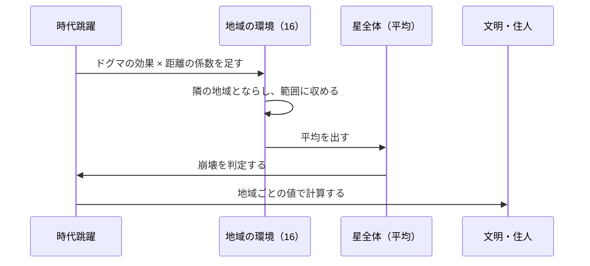

# 仕様書: 地域の環境（地域ごとの値と、地形の 2 つの層）

- テスト仕様書: まだ無い（未決を決めてから作る）
- 関連ADR: なし（セーブ形式とコアのモデルを変えるので、決まったら ADR にするか決める）
- 通信: なし（今のスマホには環境の値を送っていない）
- 画面デザイン: なし
- 出典: 2026-10-14 のチャットで決めた「5 つの土台」のうち、1（地域ごとの環境の値）と 2（地形）。3（天候）・4（住人が結果を変えてよい範囲）は次の仕様書、5（地域を選んで神託を下す。予言者の居場所を選ぶ案）は最後に別の仕様書で決める
- 着手: 未定
- 関連: [時代跳躍](time-skip.md)・[地表の表示](planet-display.md)・[文明の創発的な発展](emergent-progression.md)・[人の欲求と健康](agent-needs.md)・[予言者の依頼](prophet-request.md)・[セーブデータ](save-data.md)・[群衆](crowd.md)

## 目的

今は星全体で 1 つずつの環境の値（森林量・水資源・気温）を、16 の地域ごとに持たせる。「隣の地域のせいで自分の地域が不作になる」「この地域は海辺、あの地域は山あい」という地域の個性と、地域どうしのドラマの土台にする。食料・治水・大気汚染・熱と電気・物流・交通・疫病など、2026-10-14 に書いた構想の下書きの多くが、この土台を前提にしている。

## ゲームのルール

用語は [用語集](glossary.md) に合わせる。

### 今の仕組み（2026-10-14 時点。比べるため）
- 環境の値は、星全体で 1 つずつ: 森林量・水資源・気温・カオス度・調和度（`WorldState`）。
- ドグマの効果（`rules.json` の `dogmaEffects`）は、記号と種別ごとの 1 年の変化量 × 強度を、星全体の値に毎年足す（[時代跳躍](time-skip.md)）。
- 星全体の値を使っているところ:
  - 星の崩壊の判定（カオス度・水資源と森林量・気温）
  - 予言者の依頼（渇き・飢え・暑さ・寒さ・混乱・荒れ。[予言者の依頼](prophet-request.md)）
  - 住人の飢饉の年（森林量か水資源が 30 以下。[人の欲求と健康](agent-needs.md)）
  - 地表の塗り方（気温・水資源・森林量から、氷河・焦土・砂漠・密林を西の列から塗る。水資源で湖のマスの数を決める。[地表の表示](planet-display.md)）
  - HUD・ログ（`event=time_skipped`）・セーブ
- 地域は、地表の 32 列を 2 列ずつ区切った 16 個（`regions.columnsPerRegion`）。地域ごとに持つ値は、技術・文化と建物の段階だけ（[文明の創発的な発展](emergent-progression.md)）。
- 地域ごとの文明の伸びは、地域の 2 列のタイル種別（環境）で倍率が変わり、ドグマの効き目は予言者のいる地域から離れるほど弱まる（8 地域離れると 0）。

### 地域ごとの環境の値（案。2026-10-14 に方向を決めた）
- 16 の地域が、それぞれ森林量・水資源・気温を持つ。範囲は今の星全体の値と同じ（森林量・水資源 0〜100、気温 −50〜80）。
- カオス度・調和度は、星全体で 1 つのまま（下の「未決」）。
- **星全体の値は、16 地域の平均として計算で出す**。保存はしない。依頼・HUD・ログなど、星全体の値を使うところは、平均を使う。
- **ドグマの効果は、地域ごとに配る**。地域の 1 年の変化量 ＝ ドグマの効果 × 強度 × その地域の距離の係数（予言者のいる地域で 1、離れるほど弱まる。文明の伸びと同じ係数）。
- **隣の地域とならす**: 毎年、隣どうしの地域の値を少しずつ近づける（拡散）。ならす速さは未決。

### 地形の 2 つの層（案。2026-10-14 に方向を決めた）
- **土台の地形（固定）**: 地域ごとに 1 つ持つ。星を作ったとき（世界再創生を含む）に決め、その周回の間は変わらない。種類の案: 沿岸・平野・森林・山岳。
- **環境の異常（今の塗り方を地域ごとにしたもの）**: 地域の森林量・水資源・気温から、その地域の 2 列を氷河・焦土・砂漠・密林・草地のどれかで塗る。土台の地形の上にかぶさる。
- 今の「西の列から塗る」は、「地域ごとに、その地域の値で塗る」に変わる。
- 4 × 4 のマップに並べ直す案は採らない（今の横長の地表とカメラに合わない。2026-10-14 に決定）。

### 1 年の中の順番（案）
1. ドグマの効果を、距離の係数で地域ごとに配って足す。
2. 隣の地域とならす。
3. 値を範囲に収める。
4. 星全体の平均を出し、崩壊を判定する。
5. 文明・住人の計算（地域ごとの値を使う）。

### 変わるところ（実装の前に、処理の流れを示して確認する）
- **セーブ形式**: 地域ごとの 3 つの値と、土台の地形を保存する。`saveVersion` を上げる（15 → 16）。古い形式からの変換は作らない（[セーブデータ](save-data.md)の決まり）。
- **地表の塗り方**: 地域ごとに塗る。湖のマスの数の決め方（今は星全体の水資源）も変わる。
- **住人の飢饉**: 住人のいる地域の値で決める。
- **崩壊・依頼**: 平均で判定する（崩壊の判定の仕方は未決）。
- **文明の伸びの倍率**: 今と同じく、地域のタイル種別で決める（塗り方が地域ごとになるので、結果は変わる）。
- **群衆・環境光**: 地表のタイルを見ているので、塗り方が変われば見た目も変わる。
- **ゲームデータ**: 初期値・ならす速さ・土台の地形を `rules.json` に足す。

## 受け入れ条件

未決のうち、値に関わらない形だけを置く。値が決まったら足す。

| ID | Given（前提） | When（操作） | Then（結果） |
| :--- | :--- | :--- | :--- |
| AC-regional-environment-001 | 16 地域のうち 8 地域の水資源が 0、残りの 8 地域が 100 | 星全体の水資源を見る | 50（16 地域の平均） |
| AC-regional-environment-002 | ドグマが無く、16 地域の値がすべて同じ | 1 年を計算する | 16 地域の値は変わらない（ならしても差が無い） |
| AC-regional-environment-003 | 森林量を毎年増やすドグマが 1 つ、予言者のいる地域とそこから 8 地域以上離れた地域 | 1 年を計算する（ならす前） | 予言者のいる地域は効果 × 強度だけ増え、8 地域以上離れた地域は増えない（「未決」のドグマの効果の配り方が (a) のとき。(b)・(c) に決まったら書き直す） |
| AC-regional-environment-004 | 地域ごとの値と土台の地形を持つ星 | 保存して読み込む | 16 地域の値と土台の地形が、保存前と同じ |
| AC-regional-environment-005 | `saveVersion` 15 のセーブ | 読み込む | 読めず、新しく始める（今の版の違うセーブと同じ扱い） |

## 対象外

- 天候（雨・日照り・寒波）。次の仕様書で決める（環境の値から天候が起きる形にし、ドグマの効果と二重にしない。2026-10-14 に方向を決めた）。
- 住人が環境の値を動かすこと。次の仕様書（住人が結果を変えてよい範囲）で決める。
- 地域を選んで神託を下すこと（予言者の居場所を選ぶ案）。最後に別の仕様書で決める。
- 食料の量。[食料の生産](food-production.md)で決める（この仕様書は森林量・水資源・気温の 3 つだけ）。
- 4 × 4 のマップ（上の「地形の 2 つの層」）。

## 未決

### 地域ごとの値
- **カオス度・調和度**: 星全体のままにするか、地域ごとにするか。職業・娯楽・学問の案は地域ごとのカオス度を前提にしている。
- **ドグマの効果の配り方**: 距離の係数をそのまま掛けると、16 地域の平均の変化は今より小さくなる（離れた地域ほど効かないため）。(a) そのまま（星全体の変化が弱まり、崩壊が遅くなる）、(b) 平均が今と同じになるよう係数をそろえる、(c) 環境の値には距離の係数を掛けない（予言者の近くだけが変わるのは文明の伸びだけ）。
- **ならす速さ**: 1 年に差の何割を近づけるか。両端の地域（0 と 15）の扱い。星は輪か（東の端と西の端が隣か）。
- **初期値**: 16 地域が同じ値から始めるか、土台の地形で違う値から始めるか（沿岸は水資源が多い、山岳は気温が低い、など）。

### 崩壊と依頼
- **崩壊の判定**: 平均で判定するか、「どこか 1 つの地域が限界を越えたら」か、「半分の地域が越えたら」か。平均だと、ある地域が −50 ℃ でも、ほかが暖かければ崩壊しない。
- **依頼**: 平均で出すか、予言者のいる地域の値で出すか。

### 地形
- **土台の地形の種類**: 沿岸・平野・森林・山岳でよいか。海を土台の地形にするか（構想「異人種と海中都市」）。
- **決め方**: シードを指定した乱数で決めるか、ゲームデータの固定の並びにするか。
- **効き目**: 土台の地形で、何が変わるか（環境の値の初期値・変わりやすさ、文明の伸びの倍率、建物の建てやすさ、見た目）。
- **見た目**: 土台の地形の絵（海辺・山）を足すか。環境の異常のタイルとどう重ねるか。今の湖のマス（21〜28 列目）を、どの地域の水資源で決めるか。

### 画面
- HUD に、星全体の平均だけを出すか、カーソルの下（または選んだ）地域の値も出すか。
- スマホに地域ごとの値を送るか（今は環境の値を送っていない）。

### 用語
- 用語集に足す案: 地域の環境（Regional environment）・土台の地形（Base terrain）・環境の異常（Terrain anomaly）・ならし（Diffusion）。
