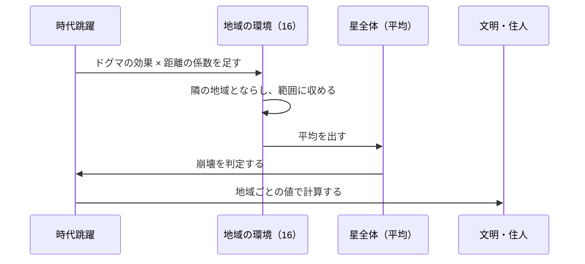

# 仕様書: 地域の環境（地域ごとの値と、地形の 2 つの層）

- テスト仕様書: まだ無い（未決を決めてから作る）
- 関連ADR: なし（セーブ形式とコアのモデルを変えるので、決まったら ADR にするか決める）
- 通信: なし（今のスマホには環境の値を送っていない）
- 画面デザイン: なし
- 出典: 2026-10-14 のチャットで決めた「5 つの土台」のうち、1（地域ごとの環境の値）と 2（地形）。3（天候）・4（住人が結果を変えてよい範囲）は次の仕様書、5（地域を選んで神託を下す。予言者の居場所を選ぶ案）は最後に別の仕様書で決める
- 着手: 未定
- 関連: [時代跳躍](time-skip.md)・[地表の表示](planet-display.md)・[文明の創発的な発展](emergent-progression.md)・[人の欲求と健康](agent-needs.md)・[予言者の依頼](prophet-request.md)・[セーブデータ](save-data.md)・[群衆](crowd.md)

## 目的

今は星全体で 1 つずつの環境の値（森林量・水資源・気温）を、16 の地域ごとに持たせる。「隣の地域のせいで自分の地域が不作になる」「この地域は海辺、あの地域は山あい」という地域の個性と、地域どうしのドラマの土台にする。食料・治水・大気汚染・熱と電気・物流・交通・疫病など、2026-10-14 に書いた構想の下書きの多くが、この土台を前提にしている。

## ゲームのルール

用語は [用語集](glossary.md) に合わせる。

### 今の仕組み（2026-10-14 時点。比べるため）
- 環境の値は、星全体で 1 つずつ: 森林量・水資源・気温・カオス度・調和度（`WorldState`）。
- ドグマの効果（`rules.json` の `dogmaEffects`）は、記号と種別ごとの 1 年の変化量 × 強度を、星全体の値に毎年足す（[時代跳躍](time-skip.md)）。
- 星全体の値を使っているところ:
  - 星の崩壊の判定（カオス度・水資源と森林量・気温）
  - 予言者の依頼（渇き・飢え・暑さ・寒さ・混乱・荒れ。[予言者の依頼](prophet-request.md)）
  - 住人の飢饉の年（森林量か水資源が 30 以下。[人の欲求と健康](agent-needs.md)）
  - 地表の塗り方（気温・水資源・森林量から、氷河・焦土・砂漠・密林を西の列から塗る。水資源で湖のマスの数を決める。[地表の表示](planet-display.md)）
  - HUD・ログ（`event=time_skipped`）・セーブ
- 地域は、地表の 32 列を 2 列ずつ区切った 16 個（`regions.columnsPerRegion`）。地域ごとに持つ値は、技術・文化と建物の段階だけ（[文明の創発的な発展](emergent-progression.md)）。
- 地域ごとの文明の伸びは、地域の 2 列のタイル種別（環境）で倍率が変わり、ドグマの効き目は予言者のいる地域から離れるほど弱まる（8 地域離れると 0）。

### 地域ごとの環境の値（案。2026-10-14 に方向を決めた）
- 16 の地域が、それぞれ森林量・水資源・気温・カオス度・調和度の 5 つを持つ（カオス度・調和度も地域ごと。2026-10-14 に決定）。範囲は今の星全体の値と同じ（森林量・水資源・カオス度・調和度 0〜100、気温 −50〜80）。
- **星全体の値は、16 地域の平均として計算で出す**。保存はしない。依頼・HUD・ログなど、星全体の値を使うところは、平均を使う。
- **ドグマの効果は、地域ごとに配る（2026-10-14 に決定）**。地域の 1 年の変化量 ＝ ドグマの効果 × 強度 × その地域の距離の係数 × そろえの倍率。
  - 距離の係数: 予言者のいる地域で 1、離れるほど直線的に弱まり、`zeroInfluenceDistance`（今は 8）地域離れると 0。文明の伸びと同じ係数。
  - そろえの倍率 ＝ 16 ÷ （16 地域の距離の係数の合計）。16 地域の平均の変化が、今の星全体の変化と同じになるようにする（今の崩壊の速さと、調整した値を保つため）。
  - 例: 星を輪にし（下）、`zeroInfluenceDistance` が 8 のとき、係数の合計は 1 ＋ 2 ×（7/8 ＋ 6/8 ＋ … ＋ 1/8）＋ 0 ＝ 8 で、そろえの倍率は 2。予言者のいる地域は今の 2 倍変わり、反対側の地域は変わらない。
- **カオス度の自然な減少**（今は星全体で毎年 0.2）は、地域ごとに同じ量を減らす。
- **隣の地域とならす**: 毎年、隣どうしの地域の値を少しずつ近づける（拡散）。ならす速さは未決。
- **星は輪にする（2026-10-14 に決定）**: 東の端の地域（15）と西の端の地域（0）は隣どうし。ならしも、予言者からの距離も、輪で数える（距離 ＝ 番号の差と 16 − 番号の差の小さいほう）。
  - 予言者は地域 8（列 16。0 から数える）にいるので、輪にしても、今の文明の伸びの距離（地域 0 まで 8、地域 15 まで 7）は変わらない。
  - 地表の見た目（横長の 1 枚）は変えない。東西の端がつながる見せ方は未決。

### 地形の 2 つの層（案。2026-10-14 に方向を決めた）
- **土台の地形（固定）**: 地域ごとに 1 つ持つ。星を作ったとき（世界再創生を含む）に、シードを指定した乱数で決め、その周回の間は変わらない。同じシードなら同じ地形になる（2026-10-14 に決定）。
- **種類は 5 つ（2026-10-14 に決定）**: 海・沿岸・平野・森林・山岳。
- **並べ方（2026-10-14 に決定）**:
  1. 海の地域の数を、乱数で 2〜4 から決める（範囲はデータ定義に置く仮の値）。
  2. 予言者のいる地域（地域 8）を除いた地域から、海の地域を乱数で選ぶ。予言者のいる地域は海にしない。
  3. 海の隣（輪で数える）の陸の地域は、すべて沿岸にする。
  4. 残りの陸の地域を、乱数で平野・森林・山岳から選ぶ。選ぶ重みはデータ定義に置く（仮の値は 1 : 1 : 1。2026-10-14 に決定）。
- **海の地域（2026-10-14 に決定）**: 住人は住まず、移り住みも起きない。家・工房・祠は建たず、技術・文化は伸びない（文明の計算をしない）。環境の値は持ち、陸と同じく、ドグマ・ならしで 5 つの値すべてが動き、星全体の平均に加わる（2026-10-14 に決定）。海底人・海中都市は、後で構想「異人種と海中都市」で足す。
- **初期値（2026-10-14 に決定）**: 今の初期値（森林量 50・水資源 100・気温 15・カオス度 0・調和度 50）に、土台の地形ごとの補正を足す（沿岸は水資源を足す、山岳は気温を下げる、など）。補正の量は、データ定義に仮の値で置き、画面で見て決める。
- **土台の地形が効くもの（2026-10-14 に決定）**: 今回は初期値と見た目だけ。文明の伸びの倍率・建物の建てやすさ・環境の変わりやすさには効かせない（食料・天候を決めるときに足す）。
- **環境の異常（今の塗り方を地域ごとにしたもの）**: 地域の森林量・水資源・気温から、その地域の 2 列を氷河・焦土・砂漠・密林・草地のどれかで塗る。土台の地形の上にかぶさる。
- 今の「西の列から塗る」は、「地域ごとに、その地域の値で塗る」に変わる。
- 4 × 4 のマップに並べ直す案は採らない（今の横長の地表とカメラに合わない。2026-10-14 に決定）。

### 1 年の中の順番（案）
1. ドグマの効果を、距離の係数で地域ごとに配って足す。
2. 隣の地域とならす。
3. 値を範囲に収める。
4. 星全体の平均を出し、崩壊を判定する（今の閾値を平均に当てる。2026-10-14 に決定）。海の地域も平均に入る。
5. 文明・住人の計算（地域ごとの値を使う）。

### 変わるところ（実装の前に、処理の流れを示して確認する）
- **セーブ形式**: 地域ごとの 3 つの値と、土台の地形を保存する。`saveVersion` を上げる（15 → 16）。古い形式からの変換は作らない（[セーブデータ](save-data.md)の決まり）。
- **地表の塗り方**: 地域ごとに塗る。湖のマスの数の決め方（今は星全体の水資源）も変わる。
- **住人の飢饉**: 住人のいる地域の値で決める。
- **崩壊**: 16 地域の平均に、今の閾値を当てる。1 つの地域が限界を越えても、平均が越えなければ崩壊しない。
- **依頼**: 予言者のいる地域（地域 8）の値で出す（2026-10-14 に決定）。予言者は自分の地域の困りごとを訴える。荒廃（廃墟の数）は今のまま星全体で数える。
- **HUD**: 予言者のいる地域の値と、星全体の平均を並べて出す（2026-10-14 に決定）。地域ごとの値をクリックで見る仕組みは、後で足す。
- **住人の SAN 値**: 毎年「カオス度 ÷ 10」減る規則は、住人のいる地域のカオス度を使う。
- **群衆**: カオス度で群衆の動き方（狂乱など）が変わるところは、平均か地域ごとかを決める（未決）。
- **文明の伸びの倍率**: 今と同じく、地域のタイル種別で決める（塗り方が地域ごとになるので、結果は変わる）。
- **群衆・環境光**: 地表のタイルを見ているので、塗り方が変われば見た目も変わる。
- **ゲームデータ**: 初期値・ならす速さ・土台の地形を `rules.json` に足す。

## 受け入れ条件

未決のうち、値に関わらない形だけを置く。値が決まったら足す。

| ID | Given（前提） | When（操作） | Then（結果） |
| :--- | :--- | :--- | :--- |
| AC-regional-environment-001 | 16 地域のうち 8 地域の水資源が 0、残りの 8 地域が 100 | 星全体の水資源を見る | 50（16 地域の平均） |
| AC-regional-environment-002 | ドグマが無く、16 地域の値がすべて同じ | 1 年を計算する | 16 地域の値は変わらない（ならしても差が無い） |
| AC-regional-environment-003 | 森林量を毎年増やすドグマが 1 つ、`zeroInfluenceDistance` 8、星は輪 | 1 年を計算する（ならす前） | 予言者のいる地域は 2 ×（効果 × 強度）増え、8 地域離れた反対側の地域は増えない。16 地域の平均の増え方は、効果 × 強度 |
| AC-regional-environment-004 | 地域ごとの値と土台の地形を持つ星 | 保存して読み込む | 16 地域の値と土台の地形が、保存前と同じ |
| AC-regional-environment-005 | `saveVersion` 15 のセーブ | 読み込む | 読めず、新しく始める（今の版の違うセーブと同じ扱い） |
| AC-regional-environment-006 | 同じシードで、星を 2 回作る | 土台の地形を見る | 16 地域の地形が 2 回とも同じ |
| AC-regional-environment-007 | どのシードでも | 星を作る | 海の地域は 2〜4 個。地域 8 は海でない。海の隣の陸の地域はすべて沿岸で、海の隣でない地域に沿岸は無い |
| AC-regional-environment-008 | 海の地域がある星 | 何年進めても | 海の地域には住人・家・工房・祠が無く、技術・文化は 0 のまま |
| AC-regional-environment-009 | 地域 8 の水資源が 30、ほかの 15 地域が 80 | 1 年を計算する（依頼の判定） | 渇きの依頼が出る（平均は 76.875 で渇きの閾値 30 より高いが、予言者のいる地域の値で判定する） |

## 対象外

- 天候（雨・日照り・寒波）。次の仕様書で決める（環境の値から天候が起きる形にし、ドグマの効果と二重にしない。2026-10-14 に方向を決めた）。
- 住人が環境の値を動かすこと。次の仕様書（住人が結果を変えてよい範囲）で決める。
- 地域を選んで神託を下すこと（予言者の居場所を選ぶ案）。最後に別の仕様書で決める。
- 食料の量。[食料の生産](food-production.md)で決める（この仕様書は森林量・水資源・気温の 3 つだけ）。
- 4 × 4 のマップ（上の「地形の 2 つの層」）。

## 未決

### 地域ごとの値
- **ならす速さ**: 1 年に差の何割を近づけるか。5 つの値で同じ速さにするか（気温は速く、森林量は遅く、など）。
- **予言者の近くの変わりやすさ**: そろえの倍率で、予言者のいる地域は今の 2 倍変わる。予言者のいる地域だけが早く限界に届き、そこの住人・建物が先に滅びる。これでよいか、遊んで確かめる。
- **初期値の補正の量**: 土台の地形ごとに、5 つの値をどれだけずらすか（海の水資源は 100 に固定するか、など）。

### 地形
- **海の森林量**: 海も森林量が動く（2026-10-14 に決定）が、海の森林量が何を表すか（海藻・海の生き物の豊かさなど）と、見た目にどう出すか。
- **海の地域にある今のもの**: 焚き火（列 12、地域 6）・湖のマス（21〜28 列目、地域 10〜13）・群衆が、海の地域に当たったときの扱い。焚き火と群衆は描画だけ。
- **見た目**: 土台の地形の絵（海辺・山）を足すか。環境の異常のタイルとどう重ねるか。今の湖のマス（21〜28 列目）を、どの地域の水資源で決めるか。

### 画面
- HUD の並べ方・文言（画面を作るときに決める）。
- スマホに地域ごとの値を送るか（今は環境の値を送っていない）。

### 用語
- 用語集に足す案: 地域の環境（Regional environment）・土台の地形（Base terrain）・環境の異常（Terrain anomaly）・ならし（Diffusion）。
