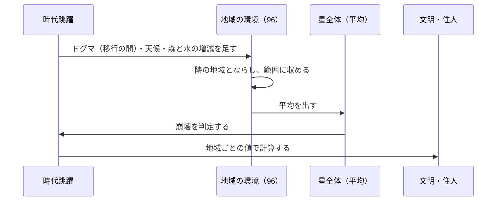

# 仕様書: 地域の環境（星全体の格子・地域ごとの値・地形の 2 つの層）

- テスト仕様書: まだ無い（未決を決めてから作る）
- 関連ADR: なし（セーブ形式とコアのモデルを変えるので、決まったら ADR にするか決める）
- 通信: なし（今のスマホには環境の値を送っていない）
- 画面デザイン: なし
- 出典: 2026-10-14 のチャットで決めた「5 つの土台」のうち、1（地域ごとの環境の値）と 2（地形）。同じ日に、緯度を入れて星全体を表すと決め直した（16 地域の帯 → 16 列 × 6 段の格子）
- 着手: 未定
- 関連: [信仰としてのドグマ](dogma-belief.md)・[気候と天候](weather.md)・[住人による森と水の利用](resource-use.md)・[時代跳躍](time-skip.md)・[地表の表示](planet-display.md)・[文明の創発的な発展](emergent-progression.md)・[人の欲求と健康](agent-needs.md)・[予言者の依頼](prophet-request.md)・[カメラの視点](camera-views.md)・[セーブデータ](save-data.md)・[群衆](crowd.md)

## 目的

今は星全体で 1 つずつの環境の値（森林量・水資源・気温・カオス度・調和度）を、星全体を覆う地域の格子ごとに持たせる。経度（東西）と緯度（南北）のある星にし、「赤道は暑く極は寒い」「海の風下は雨が多い」といった現実に寄せた気候と、「隣の地域のせいで自分の地域が不作になる」「この地域は海辺、あの地域は山あい」という地域の個性の土台にする。

## ゲームのルール

用語は [用語集](glossary.md) に合わせる。

### 今の仕組み（2026-10-14 時点。比べるため）
- 環境の値は、星全体で 1 つずつ: 森林量・水資源・気温・カオス度・調和度（`WorldState`）。
- ドグマの効果（`rules.json` の `dogmaEffects`）は、記号と種別ごとの 1 年の変化量 × 強度を、星全体の値に毎年足す（[時代跳躍](time-skip.md)）。
- 星全体の値を使っているところ:
  - 星の崩壊の判定（カオス度・水資源と森林量・気温）
  - 予言者の依頼（渇き・飢え・暑さ・寒さ・混乱・荒れ。[予言者の依頼](prophet-request.md)）
  - 住人の飢饉の年（森林量か水資源が 30 以下。[人の欲求と健康](agent-needs.md)）
  - 地表の塗り方（気温・水資源・森林量から、氷河・焦土・砂漠・密林を西の列から塗る。水資源で湖のマスの数を決める。[地表の表示](planet-display.md)）
  - HUD・ログ（`event=time_skipped`）・セーブ
- 地表は 32 列 × 18 行のタイル（1 タイル 16 px、512 × 288 px）。行はどれも同じタイルで、縦に意味が無い。
- 地域は、32 列を 2 列ずつ区切った 16 個（`regions.columnsPerRegion`）。地域ごとに持つ値は、技術・文化と建物の段階だけ（[文明の創発的な発展](emergent-progression.md)）。
- 予言者は列 16（地域 8）にいる。ドグマの文明への効き目は、予言者のいる地域から離れるほど弱まる（8 地域離れると 0）。

### 星の形と地域の格子（2026-10-14 に決定）
- 地表を、世界地図（正距円筒図法）のように読む。横は経度、縦は緯度。
- **地表を広げる**: 192 列 × 72 行のタイル（1 タイル 16 px なら 3072 × 1152 px）にする。2026-10-14 には 32 列 × 36 行（1 地域 2 列 × 6 行）と決めたが、2026-10-15 に、地域の中で集落を自由な位置に建てられるよう、1 地域を 12 × 12 タイルの格子にすると決め直した（[国と集落](polity.md)の「集落の自由な置き方」）。
- **地域は 16 列 × 6 段の 96 個**。1 つの地域は 12 列 × 12 行のタイル（144 マス。星全体で 13,824 マス）。
- **地図の縮尺**（2026-10-15 に決定）: 星を地球の大きさとすると、1 地域は東西およそ 2,500 km・南北およそ 3,300 km、1 タイルはおよそ 200 km 四方になり、家 1 軒を本当の大きさで描くことはできない。そこで 2 つの縮尺にする。
  - **星の地図（記号の縮尺）**: 1 地域 12 × 12 タイルのまま。集落は 1 つの絵で表し、人口に応じて 1 マスから 3 × 3・5 × 5 と広がる。道は集落どうしを結ぶ 1 マス幅の線。工房・祠・霊廟などの目立つ建物も、記号として置く。まずこれで作る。
  - **街の拡大（後で足す）**: 集落を拡大したときだけ、その集落の街並み（家・道・畑・広場）を、別の細かい格子で見せる。街並みは、集落の人口・発明・文化からシードを指定した乱数で毎回作れるようにし、保存を少なくする（例: Dwarf Fortress の世界の地図と各地の現場）。
  - 1 地域を 24 × 24 や 32 × 32 にして家・道を 1 つずつ並べる形は、星全体で 5〜10 万マスになり重いので選ばなかった。
- **建物の固定の枠はやめる**（2026-10-15 に決定）: 今の「2 × 2 マスの決まった枠に建つ」形をやめ、建物と集落は地域の中のタイルに自由に建つ。今の枠を前提にした決まり（家・工房・祠・霊廟・聖堂の建て方、地層の枠ごとの層）は、この段で読み替える。
- **建物の置き場所**（2026-10-15 に決定。段 1b から）:
  - 建物は、地域の中の空いた 2 × 2 タイルに建つ。4 マスとも陸で、標高が決まった高さ（仮 1500 m。山岳の範囲の下の端）より低い所だけに建てられる。
  - 建物は**寄り集まる**: 建て増しできる廃墟を先に選ぶ（今のまま）。無ければ、その地域の既存の建物に近い空き地を優先する。地域の最初の 1 軒は、低くて海に近い陸を優先する。候補の中からは、シードを指定した乱数で選ぶ。現実の村が水辺に生まれ、家が寄り集まって育つのに寄せた。段 3 で集落ができたら、この寄り集まりが集落の芽になる。
  - 「近い」「優先する」の重み（距離・標高・海までの距離）は仮の値にする。
- **地層の持ち方**（2026-10-15 に決定。段 1b から）: 遺物は建物の足元（2 × 2）ごとに持つ。新しく沈む遺物と足元が 1 マスでも重なる遺物は、すべて 1 層深くなる。地下は 20 層まで（[地層](strata.md)）。
- 段は、上から北の極・北の中緯度・北の低緯度・南の低緯度・南の中緯度・南の極にあたる。現実の大気の 3 つの循環（極・偏西風・貿易風）を、北と南にそれぞれ持てる。
- **横は輪**: 東の端の列と西の端の列は隣どうし。
- **縦はつながらない**: いちばん上（北の極）といちばん下（南の極）は隣でない。その 2 つの段がいちばん寒い。
- **隣と距離**: 斜めも隣（8 方向）。2 つの地域の距離は、横の歩数（輪で数え、差と 16 − 差の小さいほう）と縦の歩数の大きいほう。ならし・天候の動き・人の移動・予言者からの距離は、この隣と距離で数える。

### 地域ごとの環境の値（2026-10-14 に決定）
- 96 の地域が、それぞれ森林量・水資源・気温・カオス度・調和度の 5 つを持つ。範囲は今の星全体の値と同じ（森林量・水資源・カオス度・調和度 0〜100、気温 −50〜80）。
- **星全体の値は、96 地域の平均として計算で出す**。保存はしない。HUD・ログなど、星全体の値を使うところは、平均を使う。
- **カオス度の自然な減少**（今は星全体で毎年 0.2）は、地域ごとに同じ量を減らす。
- **隣の地域とならす**: 毎年、隣どうし（8 方向）の地域の値を少しずつ近づける（拡散）。ならす速さは未決。
- **気候の基準**: 段ごとに、気温の基準の値を持つ（赤道に近い段ほど高く、極の段ほど低い）。地域の気温は、この基準へ毎年戻ろうとする（[気候と天候](weather.md)）。値は係数として未決。

### ドグマの効果の配り方（移行の間だけ）
- [信仰としてのドグマ](dogma-belief.md)で、ドグマは環境の値を直接変えず、人の行動を通して効くと決めた（2026-10-14）。下は、それに切り替えるまでの間だけの扱い。
- 地域の 1 年の変化量 ＝ ドグマの効果 × 強度 × その地域の距離の係数 × そろえの倍率。
  - 距離の係数: 予言者のいる地域で 1、離れるほど直線的に弱まり、`zeroInfluenceDistance`（今は 8）離れると 0。
  - そろえの倍率 ＝ 地域の数 ÷（すべての地域の距離の係数の合計）。全地域の平均の変化が、今の星全体の変化と同じになるようにする。予言者の居場所で合計が変わるので、倍率も変わる。

### 地形の 2 つの層（2026-10-14 に決定）
- **土台の地形（固定）**: 地域ごとに 1 つ持つ。星を作ったとき（世界再創生を含む）に、シードを指定した乱数で決め、その周回の間は変わらない。同じシードなら同じ地形になる。
- **種類は 5 つ**: 海・沿岸・平野・森林・山岳。
- **並べ方**:
  1. 予言者の最初の地域を、乱数で決める（下の「予言者」）。
  2. 海の割合を、3〜4 割の間で乱数で決める（範囲はデータ定義に置く仮の値）。
  3. **大陸の塊を作る**: 乱数で大陸の種をいくつか置き、隣（8 方向）へ広げて陸の塊にする。陸が「1 − 海の割合」に届いたら止め、残りを海にする。予言者の最初の地域は、必ず陸にする。
  4. 海の隣（8 方向）の陸の地域は、すべて沿岸にする。
  5. 残りの陸の地域を、乱数で平野・森林・山岳から選ぶ。選ぶ重みはデータ定義に置く（仮の値は 1 : 1 : 1）。
- **島**（2026-10-15 に決定。島国ができるように）: 島は 2 つの大きさで作る。1 地域はおよそ 530 万 km²、1 タイルはおよそ 3.7 万 km² なので、日本・イギリスの大きさ（6〜10 タイル）は地域の単位では作れないため。
  - **地域の島**（オーストラリア・グリーンランドの大きさ）: 大陸の種とは別に「島の種」を置き、どの陸の地域とも隣り合わない（8 方向）海の地域を 1〜2 地域の陸にする。陸の数の目標に含める。土台の地形は、ほかの陸と同じ決め方（海に囲まれるので沿岸になる）。
  - **タイルの島**（日本・イギリスの大きさ）: 地域の土台の地形は海のまま、海のタイルの一部を陸にする。現実の島のでき方に合わせた 3 種類。
    - 島弧: プレートの境目の海の地域に、小さな島が並ぶ（日本・インドネシア）。火山なので高い。
    - ホットスポット: 陸から離れた海の地域に、ごく小さな島（ハワイ）。
    - 大陸棚の島: 沿岸の浅い海から少し離れて、大陸の脇にできる（イギリス）。
  - タイルの島は、タイルの陸として人が住み、集落が建つ（[国と集落](polity.md)）。地域の値（気候など）は、地域の土台の地形のまま。
- **海の地域**: 住人は住まず、移り住みも起きない。家・工房・祠は建たず、技術・文化は伸びない（文明の計算をしない）。環境の値は持ち、陸と同じく 5 つの値すべてが動き、星全体の平均に加わる。海底人・海中都市は、後で構想「異人種と海中都市」で足す。
- **初期値**: 段ごとの気候の基準と、今の初期値（森林量 50・水資源 100・気温 15・カオス度 0・調和度 50）をもとに、土台の地形ごとの補正を足す（沿岸は水資源を足す、山岳は気温を下げる、など）。補正の量は、データ定義に仮の値で置き、画面で見て決める。
- **土台の地形が効くもの**: 初期値・見た目と、気候（高さ。山の雨陰・川の流れる向き・海の湿り。[気候と天候](weather.md)）。文明の伸びの倍率・建物の建てやすさには効かせない。
- **タイルの層（2026-10-15 に決定）**: 地域の中の 12 × 12 のタイルは、**地形の細部と占有だけ**を持つ。
  - 地形の細部（案）: 標高、川が通るか、鉱脈、土（[自然の種類](natural-kinds.md)）。地域の土台の地形（海・沿岸・平野・森林・山岳）に合わせて、星を作るときにシードを指定した乱数で作る（山岳の地域は高いタイルが多い、沿岸の地域は海のタイルと陸のタイルが混ざる、など）。
  - 占有: そこに建つもの（集落の家並み・畑・建物・境界の印・廃墟）。
  - 気候（風・気温・湿りと雨・水資源・森林量）とカオス度・調和度は、**地域ごと**の値と式のまま（[気候と天候](weather.md)）。タイルへは、地形に応じて配って見せる（例: 地域の森林量に応じて、森のタイルの数が変わる。川のタイルは水が多く見える）。
- **プレートと山岳**: 星を作るとき、先にプレートを決め、山岳はプレートの境目にできやすくする（[気候と天候](weather.md)の「地震」）。
- **環境の異常（今の塗り方を地域ごとにしたもの）**: 地域の森林量・水資源・気温から、その地域のタイル（12 × 12）を氷河・焦土・砂漠・密林・草地のどれかで塗る。土台の地形の上にかぶさる。今の「西の列から塗る」はやめる。

### 予言者（2026-10-14 に決定）
- 予言者の最初の地域は、星を作るときに乱数で決める（陸の地域）。
- 予言者を動かす操作は、[コアループ](core-loop.md)の未決「予言者の居場所の選び方」で決める。
- 依頼は、予言者のいる地域の値で出す。予言者は自分の地域の困りごとを訴える。荒廃（廃墟の数）は今のまま星全体で数える。

### 1 年の中の順番（案）
1. ドグマの効果（移行の間だけ）・天候の効き目（[気候と天候](weather.md)）・森林量と水資源の自然な戻りと住人の利用（[住人による森と水の利用](resource-use.md)）を、地域ごとに足す。
2. 隣の地域とならす。
3. 値を範囲に収める。
4. 星全体の平均を出し、崩壊を判定する（今の閾値を平均に当てる）。海の地域も平均に入る。
5. 文明・住人の計算（地域ごとの値を使う）。

### 変わるところ（実装の前に、処理の流れを示して確認する）
- **地表の大きさ**: 32 × 18 → 192 × 72 タイル（2026-10-15 に 32 × 36 から決め直した）。タイルの塗り方・湖のマス・建物の枠・群衆の歩ける範囲・焚き火の位置が変わる。
- **画面**: 地表の窓（480 × 270）に星全体が入らなくなる。ズームの段に、もっと引いた倍率を足し、いちばん引いたときに星全体が入るようにする。カメラは縦にも動かす（[カメラの視点](camera-views.md)）。
- **セーブ形式**: 96 地域の 5 つの値と土台の地形、予言者の地域を保存する。`saveVersion` を上げる（15 → 16）。古い形式からの変換は作らない（[セーブデータ](save-data.md)の決まり）。
- **住人・建物の地域**: 地域の番号が 2 次元になる。住人の飢饉・SAN 値（カオス度 ÷ 10）は、住人のいる地域の値で決める。
- **崩壊**: 96 地域の平均に、今の閾値を当てる。1 つの地域が限界を越えても、平均が越えなければ崩壊しない。2026-10-15 に、人の数ができた段で「星の人口が 0 になったとき」に切り替えると決めた（[星の崩壊と文明の崩壊](collapse.md)）。これは、それまでの経過措置にする。
- **HUD**: 予言者のいる地域の値と、星全体の平均を並べて出す。地域ごとの値をクリックで見る仕組みは、後で足す。
- **群衆**: カオス度で群衆の動き方（狂乱など）が変わるところは、平均か地域ごとかを決める（未決）。
- **文明の伸びの倍率**: 今と同じく、地域のタイル種別で決める（塗り方が地域ごとになるので、結果は変わる）。
- **ゲームデータ**: 地表の大きさ・段の数・初期値と補正・ならす速さ・海の割合・地形の重みを `rules.json` に足す。

## 受け入れ条件

値に関わらない形だけを置く。値が決まったら足す。

| ID | Given（前提） | When（操作） | Then（結果） |
| :--- | :--- | :--- | :--- |
| AC-regional-environment-001 | 96 地域のうち 48 地域の水資源が 0、残りの 48 地域が 100 | 星全体の水資源を見る | 50（96 地域の平均） |
| AC-regional-environment-002 | ドグマも天候も住人も無く、96 地域の値がすべて同じ | 1 年を計算する | 96 地域の値は変わらない（ならしても差が無い） |
| AC-regional-environment-003 | 森林量を毎年増やすドグマが 1 つ（移行の間の扱い） | 1 年を計算する（ならす前） | 予言者のいる地域がいちばん増え、予言者から `zeroInfluenceDistance` 以上離れた地域は増えない。96 地域の平均の増え方は、効果 × 強度 |
| AC-regional-environment-004 | 地域ごとの値・土台の地形・予言者の地域を持つ星 | 保存して読み込む | 96 地域の値・土台の地形・予言者の地域が、保存前と同じ |
| AC-regional-environment-005 | `saveVersion` 15 のセーブ | 読み込む | 読めず、新しく始める（今の版の違うセーブと同じ扱い） |
| AC-regional-environment-006 | 同じシードで、星を 2 回作る | 土台の地形と予言者の地域を見る | 2 回とも同じ |
| AC-regional-environment-007 | どのシードでも | 星を作る | 海の地域は全体の 3〜4 割。予言者の最初の地域は陸。海の隣（8 方向）の陸の地域はすべて沿岸で、海の隣でない地域に沿岸は無い |
| AC-regional-environment-008 | 海の地域がある星 | 何年進めても | 海の地域には住人・家・工房・祠が無く、技術・文化は 0 のまま |
| AC-regional-environment-009 | 予言者のいる地域の水資源が 30、ほかの 95 地域が 80 | 1 年を計算する（依頼の判定） | 渇きの依頼が出る（平均は渇きの閾値 30 より高いが、予言者のいる地域の値で判定する） |
| AC-regional-environment-010 | 横の端の地域（列 15） | 隣を数える | 列 0 の同じ段と、その上下の段の地域も隣に入る（横は輪）。いちばん上の段の地域の隣に、いちばん下の段の地域は入らない |

## 対象外

- 予言者を動かす操作。[コアループ](core-loop.md)の未決として、別の仕様書で決める。
- 食料の量。[食料の生産](food-production.md)で決める。
- 極を 1 つの地域にまとめること（球では極は点だが、格子を崩さないため、段のまま扱う。2026-10-14 に決定）。

## 未決

### 地域ごとの値
- **ならす速さ**: 1 年に差の何割を近づけるか。5 つの値で同じ速さにするか（気温は速く、森林量は遅く、など）。斜めの隣を、上下左右と同じ重みにするか。
- **段ごとの気候の基準**: 気温の基準の値と、雨の多い段・乾いた段（現実では赤道付近は雨が多く、緯度 30 度あたりは乾く）。天候の書き直しで決める。
- **初期値の補正の量**: 土台の地形ごとに、5 つの値をどれだけずらすか。

### 地形
- **大陸の作り方の値**: 広げ方（どの向きに伸びやすいか）。島の数と大きさは、1a の plan の仮の値（2026-10-15）を画面で見て決める。
- **海の地域の島のタイル**: 海の地域でもタイルの島には人が住む。上の「海の地域: 住人は住まず」は、海のタイルのことと読み替えるか（段 3 の人のまとまりの前に決める）。
- **断層**: 地震の起きる断層を、大陸の境目に置くか（天候の書き直しで決める）。
- **海の森林量**: 海も森林量が動くが、何を表すか（海藻・海の生き物の豊かさなど）と、見た目にどう出すか。
- **今の湖と焚き火**: 湖のマス（今は 21〜28 列目・7〜12 行目）と焚き火（列 12）を、新しい地表でどう置くか。海ができるので、湖をやめるか、陸の中の湖として残すか。
- **見た目**: 土台の地形の絵（海・海辺・山）。環境の異常のタイルとどう重ねるか。

- **タイルの地形の作り方**: 標高・川・鉱脈・土の作り方と、地域の土台の地形との合わせ方。川のタイルを、[気候と天候](weather.md)の地域の川（いちばん低い隣の地域へ流れる）とどうつなぐか。
- **建物の置き場所の重み**: 2026-10-15 に、寄り集まる・陸で低い所・地層は足元ごとと決めた（上の「建物の固定の枠はやめる」）。残りは、近さ・標高・海までの距離の重み、霊廟・聖堂（[聖地](holy-site.md)）を聖地の場所に建てる決め方。
- **街の拡大**: 街並みの格子の大きさ、作り方（人口・発明・文化から何を並べるか）、星の地図から拡大への切り替え（[カメラの視点](camera-views.md)の詳細の視点との関係）、住人をどちらで描くか。
- **重さ**: 13,824 マスの描画・群衆の歩ける範囲・ポテンシャルフィールドの計算・セーブの大きさ。

### 画面
- いちばん引いた倍率の値と、ズームの段の並び。
- 横が輪であることの見せ方（カメラが東西の端でつながって回るか、端で止まるか）。
- HUD の並べ方・文言。
- スマホに地域ごとの値を送るか。スマホに映す画面（今は 480 × 270）。

### 用語
- 用語集に足す案: 地域の環境（Regional environment）・土台の地形（Base terrain）・環境の異常（Terrain anomaly）・ならし（Diffusion）・段（Latitude band）・大陸（Continent）。
