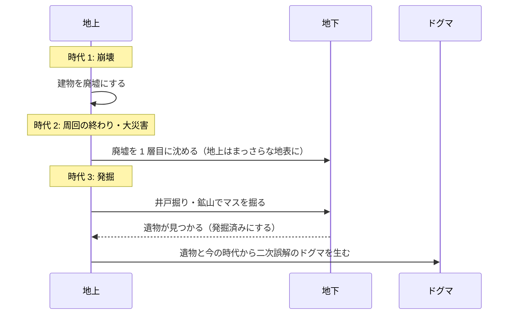
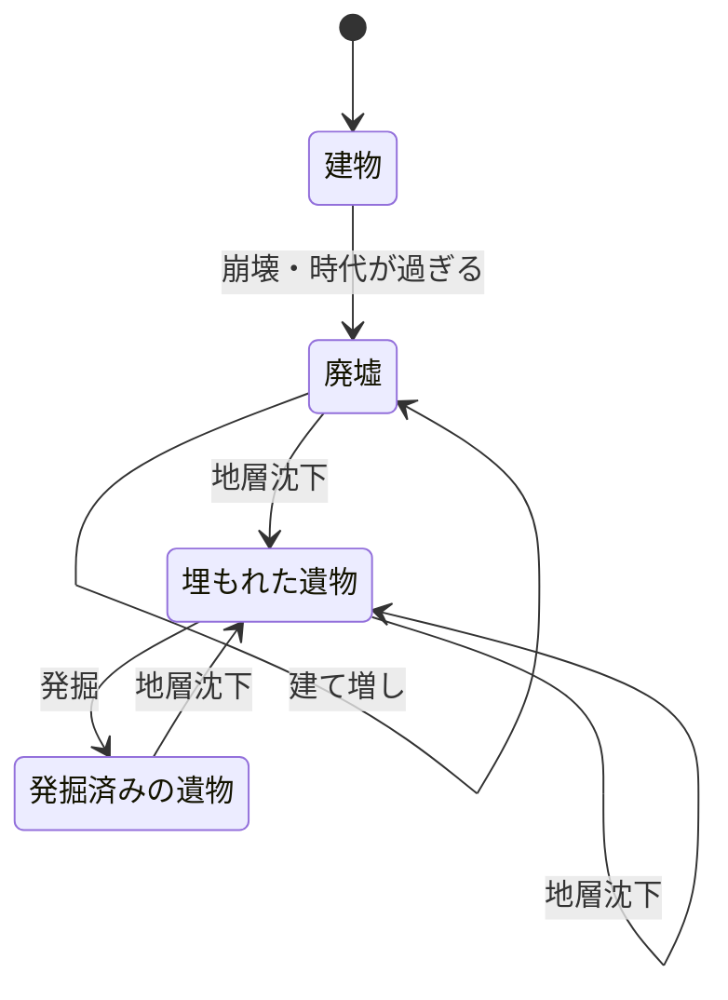

# 仕様書: 地層（積層建築と地下の発掘）

- テスト仕様書: なし（受け入れ条件が決まってから書く）
- 関連ADR: なし
- 通信: なし
- 画面デザイン: なし
- 出典: 2026-10-12 のチャットで受け取った指示書「M4: Layered Architecture & Subsurface Archaeology Specification」
- 着手: [ロードマップ](../roadmap.md)の M4 の構想（地層重ね建て・時代の推移）

## 目的

時代の推移（Epoch）にともなう文明の発展と崩壊を、地表に残る廃墟と、地中に積み重なる地層として見せる。滅びた文明の遺物を後の時代の人間が掘り当て、それを誤解して新しいドグマが生まれる（二次誤解）ことで、神の介入の歴史が時代をまたいで歪みながら受け継がれる様子を眺められるようにする。

## ゲームのルール

用語は [用語集](glossary.md) に合わせる。指示書の内容を写したもので、数値・条件の多くは「未決」にある。

### 2 つの視点
- **地上（積層建築）**: 前の時代に崩れた建物の土台・石垣（廃墟）の上に、新しい時代の人間が建物を建て増す。
- **地下（地層の断面）**: 時代の変化や大災害で地中に埋もれた前の文明の層がある。人間（や地底人）が掘ると、前の時代の遺物が見つかる。
- 地上と地下は、カメラかボタンで切り替えて見る。

### 時代（Epoch）
- 時代は 原始（`Primitive`）→ 古代（`Ancient`）→ 中世（`Medieval`）→ 現代（`Modern`）→ SF 未来（`SciFi`）→ 地底都市（`Subterranean`）の 6 つ。
- 建物は、建てられた時代を持つ。時代ごとに建物の見た目（木造・鉄骨など）が変わる。

### 廃墟化と建て増し
- 建物が崩れたとき・時代跳躍で時代が過ぎたときは、建物を消さずに廃墟（土台）にする。
- 新しい時代の建物を、廃墟のあるマスに建てるときは、廃墟を取り壊さずに、その上に重ねて建てる。建物は、下にある廃墟を指す。

### 地層沈下
- 周回の終わり（1000 年完走）か、大災害（隕石・地殻変動）が起きたとき、地上の廃墟を地下の 1 層目に押し込み、地上をまっさらな地表で覆う。
- 地下は 1〜3 層まである（地上を 0 層とする）。

### 発掘と二次誤解
- 人間が井戸掘り・鉱山の開発などであるマスを掘ると、そのマスの地下の遺物が見つかることがある。見つかった遺物は「発掘済み」になる。
- 見つかった遺物と今の時代から、歪んだ新しいドグマ（二次誤解）が生まれる。
  - 例: 前の文明の神殿から石油が見つかり、「古代人はこの黒い液体を聖水と崇めていた」と誤解して、石油崇拝のドグマが生まれる。
- 二次誤解のドグマはゲームの計算に影響するので、コアで決定的に生まれる（同じシード・同じ入力からは同じドグマになる）。言葉による見せ方を AI に任せる場合も、[AI による表現](ai-presentation.md)の決定性の境界に従う。

### 処理の流れ

### 状態遷移（建物・遺物）

1 つのマスの建物・遺物の状態。きっかけの条件は「未決」を参照。

| 現在の状態 ＼ きっかけ | 崩壊・時代が過ぎる | 地層沈下 | 発掘 | 建て増し |
| :--- | :--- | :--- | :--- | :--- |
| 建物 | 廃墟 | 不可 | 不可 | 不可 |
| 廃墟（地上） | 不可 | 埋もれた遺物 | 不可 | 廃墟（上に新しい建物が建つ） |
| 埋もれた遺物（地下） | 不可 | 埋もれた遺物（1 層深くなる） | 発掘済みの遺物 | 不可 |
| 発掘済みの遺物（地下） | 不可 | 埋もれた遺物（1 層深くなる） | 不可 | 不可 |

## 受け入れ条件

まだ書かない。下の「未決」のうち、時代の推移の条件・周回の終わり・沈下・発掘・二次誤解の規則が決まってから書く。

## 対象外

- 二次誤解のドグマを、AI の出力で決めること（決定性を保つため。[AI による表現](ai-presentation.md)の決定性の境界）。

## 未決

### 前提になる仕組み
- **建物が無い**: 今のコードに建物のモデルは無い。廃墟化・建て増しの前に、建物を誰が・いつ・どこに建てるか（[ロードマップ](../roadmap.md)の構想「自律建築」）を決める。
- **時代の推移の条件**: 時代が移る条件（年・カオス度・ドグマなど）が無い。[時代跳躍](time-skip.md)では時代の推移を MVP の範囲外にしている。
- **周回の終わり**: 「1000 年完走」で周回が終わる仕組みは無い。今は星の崩壊と世界再創生だけで、世界再創生は年・環境・ドグマを初期値に戻す（[時間の操作](time-control.md)）。地層を周回をまたいで残すなら、世界再創生で何を残し何を戻すかを決め直す。[AI による表現](ai-presentation.md)の未決「周回の終わり」と一緒に決める。
- **大災害**: 隕石・地殻変動の起きる条件と効果が無い。ロードマップの M4「イベント」と一緒に決める。

### 規則と値
- 地下が 3 層で満ちているときに沈下が起きたら、いちばん深い層をどうするか（消す・残す）。
- 発掘のきっかけ（井戸掘り・鉱山）を誰が起こすか。人間（NPC）の行動か、神の操作か。[群衆](crowd.md)は見た目だけでシミュレーションの結果に影響しないので、群衆の動きを発掘のきっかけにはできない。
- 発掘で遺物が見つかる条件と確率、1 回の発掘で掘る深さ。
- 遺物の ID の一覧と、それぞれが何に由来するか（前の時代のドグマ・建物の種類など）。
- 二次誤解で生まれるドグマの種別（`DogmaType`）と強度（`Intensity`）の決め方。今の `DogmaType` は禁忌・崇拝・破壊の 3 つで、「石油崇拝」のような内容を持たない。ドグマのモデルを変えるなら、ロードマップの構想「世代交代と教義の変質」「歴史の神話化」と一緒に決める。
- 状態遷移表の「不可」のうち、指示書に書かれていないもの（建物のまま沈下する、発掘済みの遺物を掘り直すなど）。今は不可と仮に置いた。
- 地底人の扱い（指示書の「人間や地底人が発掘する」）。

### 画面
- **クォータービュー**: 指示書は地上をクォータービュー（Y ソート）で描くが、今の地表は 256 × 144 px を上から見たタイルで、群衆・力の場・湖もこれを前提にしている。視点を変えるか、建物の格子（32 px）・カメラ（ズーム）をどうするかを決める（自律建築の未決と同じ）。
- 地下の断面の見せ方（地質の層: 粘土・岩盤・溶岩、埋もれた遺跡）と、地上との切り替えの操作。

### 実装上の注意
- 指示書のデータモデル案は、座標に `Vector2I`（Godot の型）を使う。コア（`src/TheogonyX.Core/`）は Godot に依存させないので、コアでは自前の座標の型を使う。
- 時代・廃墟・地下の層をセーブに残すと、セーブの形が変わる（`saveVersion` を上げる。[save-data.md](save-data.md)）。

### 用語
- 時代（Epoch）・廃墟（Ruins）・建て増し（Overbuild）・地層沈下（Subduction）・発掘（Excavation）・遺物（Relic）・二次誤解（Secondary misinterpretation）を用語集に足すか。今の用語集の「地層（Strata）」の意味（滅びた文明が遺跡として蓄積したもの）を、地下の層に合わせて書き換えるか。
