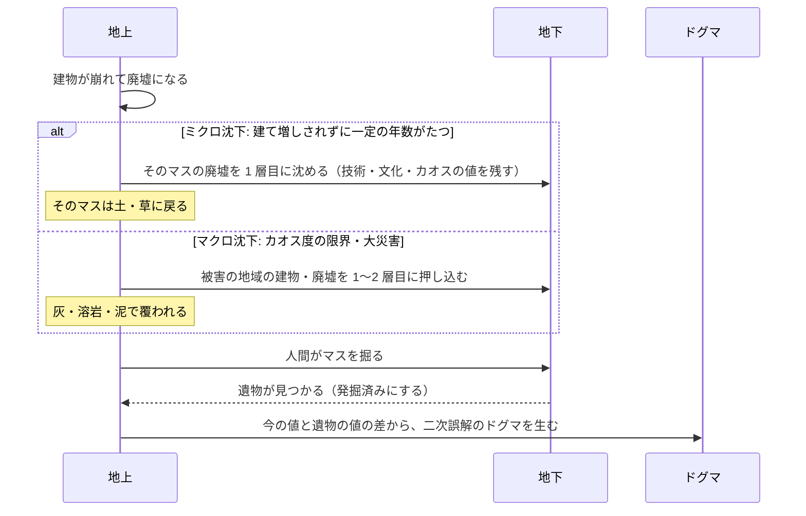
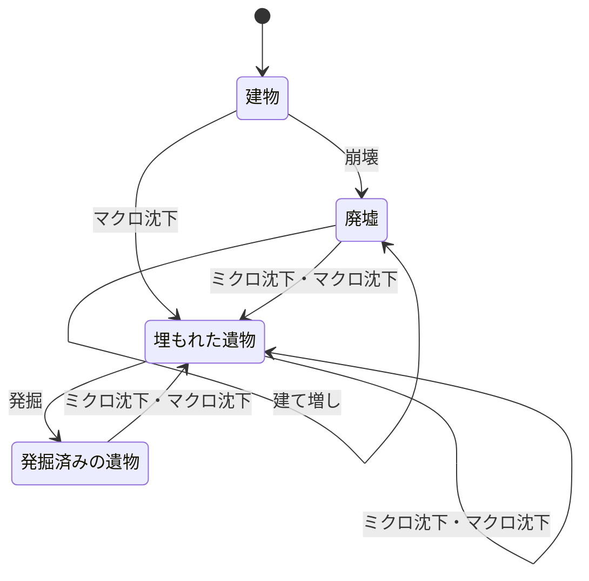

# 仕様書: 地層（積層建築と地下の発掘）

- テスト仕様書: なし（受け入れ条件が決まってから書く）
- 関連ADR: なし
- 通信: なし
- 画面デザイン: なし
- 出典: 2026-10-12 のチャットで受け取った指示書「M4: Layered Architecture & Subsurface Archaeology Specification」、同じ日の更新案「⑤ 連続値スナップショット型・地層システム」と指示書「M4: Top-Down 3/4 View & Visual Pipeline Specification」
- 着手: [ロードマップ](../roadmap.md)の M4 の構想（地層重ね建て）
- 関連: [文明の創発的な発展](emergent-progression.md)（技術・文化・カオスの 3 つの値）

## 目的

文明の発展と崩壊を、地表に残る廃墟と、地中に積み重なる地層として見せる。固定の時代区分の代わりに、建物が埋もれた瞬間の文明の状態（技術・文化・カオスの値）を地層に残す。後の人間がそれを掘り当て、自分たちとの違いから誤解して新しいドグマが生まれる（二次誤解）ことで、神の介入の歴史が歪みながら受け継がれる様子を眺められるようにする。

## ゲームのルール

用語は [用語集](glossary.md) に合わせる。指示書の内容を写したもので、数値・条件の多くは「未決」にある。

### 視点の方式（Top-Down 3/4）
- 地上は、真上から見た正方形の格子のまま描き、32 × 32 px の絵の中に建物の屋根と正面の壁を一緒に描いて、手前に倒したジオラマのように見せる（2026-10-12 に決定）。アイソメトリック（菱形の格子）にはしない。
  - 座標は今の地表と同じ 2D の直交座標（列・行）のままにする。列ごとの地域の計算や群衆の動きは変わらない。
- 廃墟の上の建物は、Y ソート（画面の下にあるものほど手前に描く）で、廃墟の絵の上にそのまま重ねて描く。

### 地表の広さと建物の大きさ（2026-10-12 に決定）
- 地表を 32 列 × 18 行（512 × 288 px、1 マス 16 × 16 px）に広げる（2026-10-12 に広げた。[星の表示](planet-display.md)）。
- 建物は 32 × 32 px で、2 × 2 マスを使う。建物が建つ規則は[文明の創発的な発展](emergent-progression.md)の「建物が建つ」にある。
- 2 列で 1 つの地域（全部で 16 地域）とする。

### 2 つの視点
- **地上**: 眺めるときの基本の画面。今の人間の営み、新しい建物、まだ地表に残っている廃墟（建て増しの土台）が見える。
- **地下の断面**: ボタン 1 つ（かカメラのズーム）で切り替える。地下の 1〜3 層目が見え、過去にどんな文明（技術・文化・カオスの値）が埋もれたかが、化石のように地中に残っているのを確かめられる。

### 廃墟化と建て増し
- 戦争・災害・老朽化で建物が崩れたら、建物を消さずに廃墟（土台）にする。
- 新しい建物を廃墟のあるマスに建てるときは、廃墟を取り壊さずに、その上に重ねて建てる。建物は、下にある廃墟を指す。

### 地層沈下（2 つのきっかけ）
固定の時代や時代跳躍による一斉の沈下はしない。次の 2 つで、地上から地下へ少しずつ沈む。地下は 1〜3 層まである（地上を 0 層とする）。

- **ミクロ沈下（風化・埋没）**: 廃墟のまま、誰も建て増ししないで一定の年数（例: 150 年）がたつと、風化と土砂の堆積で、そのマスの廃墟が地下 1 層目に沈む。地上のそのマスはまっさらな土・草に戻り、また建てられるようになる。
- **マクロ沈下（天変地異・地域の崩壊）**: カオス度が限界を超えたとき、または隕石・大噴火・大洪水などの大災害が起きたとき、被害を受けた地域の地上のもの（建物・廃墟）が一斉に地下 1〜2 層目に押し込まれる。地上は灰・溶岩・泥で覆われる。

### 地層に残すもの
- 時代の名前ではなく、埋もれた瞬間の状態を残す。
  - 埋もれた瞬間の地域の技術・文化の値と、星のカオス度（÷ 100）（[文明の創発的な発展](emergent-progression.md)）
  - 元の建物の種類（絵の ID）
  - そのとき広まっていたドグマ
  - マスの位置と、地下の何層目か

### 世界再創生と地層（2026-10-12 に決定）
- 世界再創生では、今どおり年を 0 に、環境とドグマを初期値に戻す（[時間の操作](time-control.md)）。
- 地上に建っていた建物と廃墟は、すべてそのときの値（上の「地層に残すもの」）と一緒に地下 1 層目に沈め、残す。マクロ沈下と同じく、すでに埋もれている遺物は深くなる。
- 新しい周回の人間が地下を掘ると、前の周回で育てた文明の遺物が見つかり、二次誤解が生まれる。
- 「1000 年完走」で周回が終わる仕組みは作らない。

### 発掘と二次誤解
- 人間が地下を掘り、遺物を見つけると、「今の人間（地域）の技術・文化・カオスの値」と「遺物に残った値」の差から、新しい歪んだドグマ（二次誤解）が生まれる。見つかった遺物は「発掘済み」になる。
  - 例: 技術の高い今の人間が、文化（狂信）が高く技術の低い文明の「血の儀式用の仮面」を掘る → 「古代人はこれを呼吸のフィルターにして毒ガスに耐えていた」→ 生体フィルターの教義
  - 例: 原始的な人間が、技術が高く文化の低い文明の「錆びた巨大な歯車」を掘る → 「太陽を動かしていた神の車輪だ」→ 大歯車の信仰
- 二次誤解で生まれるドグマはゲームの計算に影響するので、コアがゲームデータの表とシードを指定した乱数で決める（同じシード・同じ入力からは同じドグマになる）。AI は、誤解の言葉（セリフ・ログ）だけを作る（[AI による表現](ai-presentation.md)の決定性の境界。[文明の創発的な発展](emergent-progression.md)と同じく 2026-10-12 の決定に合わせた）。

### 処理の流れ

### 状態遷移（建物・遺物）

1 つのマスの建物・遺物の状態。きっかけの条件は「未決」を参照。

| 現在の状態 ＼ きっかけ | 崩壊 | ミクロ沈下 | マクロ沈下 | 発掘 | 建て増し |
| :--- | :--- | :--- | :--- | :--- | :--- |
| 建物 | 廃墟 | 不可 | 埋もれた遺物 | 不可 | 不可 |
| 廃墟（地上） | 不可 | 埋もれた遺物 | 埋もれた遺物 | 不可 | 廃墟（上に新しい建物が建つ） |
| 埋もれた遺物（地下） | 不可 | 埋もれた遺物（1 層深くなる） | 埋もれた遺物（深くなる） | 発掘済みの遺物 | 不可 |
| 発掘済みの遺物（地下） | 不可 | 埋もれた遺物（1 層深くなる） | 埋もれた遺物（深くなる） | 不可 | 不可 |

## 受け入れ条件

まだ書かない。下の「未決」のうち、沈下・発掘・二次誤解の規則と値が決まってから書く。

## 対象外

- 固定の時代区分（`EpochType`）と、時代跳躍による一斉の沈下: 2026-10-12 にやめた。
- 二次誤解のドグマを、AI の出力で決めること（決定性を保つため）。

## 未決

### 前提になる仕組み
- **地域**: マクロ沈下の「被害を受けた地域」と、二次誤解の「今の人間（地域）の値」は、地表の列を単位にする（[文明の創発的な発展](emergent-progression.md)。2026-10-12 に決定）。被害が何列に及ぶかは「規則と値」で決める。
- **建物が崩れるきっかけ**: 「戦争・災害・老朽化」で廃墟になるが、それぞれが起きる条件は無い。[文明の創発的な発展](emergent-progression.md)のパラドックス（自滅）と、ロードマップの M4「イベント」と一緒に決める。
- **大災害**: 隕石・大噴火・大洪水などの起きる条件・被害の範囲・効果が無い。ロードマップの M4「イベント」と一緒に決める。

### 規則と値
- ミクロ沈下の年数（例は 150 年）。廃墟になった年を数え始めとするか。
- マクロ沈下の「カオス度の限界」の値。今のカオス度は星全体の値で、星の崩壊の判定にも使っている。崩壊との違い。
- マクロ沈下で 1 層目に押し込むか 2 層目に押し込むかの決め方と、すでに埋もれている遺物をいくつ深くするか。
- 地下が 3 層で満ちているときに沈下が起きたら、いちばん深い層をどうするか（消す・残す）。
- 建て増しされた廃墟の上の建物がまた崩れたとき、廃墟が重なるか。
- 発掘のきっかけ（井戸掘り・鉱山）を誰が起こすか。人間の行動か、神の操作か。[群衆](crowd.md)は見た目だけでシミュレーションの結果に影響しないので、群衆の動きを発掘のきっかけにはできない。
- 発掘で遺物が見つかる条件と確率、1 回の発掘で掘る深さ。
- 二次誤解の表: 値の差（技術・文化・カオスのどれがどれだけ違うか）と遺物の種類から、どのドグマが生まれるか。生まれるドグマの種別（`DogmaType`）と強度（`Intensity`）。今の `DogmaType` は禁忌・崇拝・破壊の 3 つで、「生体フィルターの教義」のような内容を持たない。ドグマのモデルを変えるなら、ロードマップの構想「世代交代と教義の変質」「歴史の神話化」と一緒に決める。
- 状態遷移表の「不可」のうち、指示書に書かれていないもの（発掘済みの遺物を掘り直すなど）。今は不可と仮に置いた。
- 地底人の扱い（最初の指示書の「人間や地底人が発掘する」）。

### 画面
- 地下の断面の見せ方（地質の層: 粘土・岩盤・溶岩、埋もれた遺跡、残った値の見せ方）と、地上との切り替えの操作（ボタンかズームか）。
- マクロ沈下の後の灰・溶岩・泥を、今のタイル種別（焦土など）で表すか、新しく足すか。

### 実装上の注意
- 指示書のデータモデル案（`BuriedRelicNode`）は、座標に `Vector2I`（Godot の型）を使う。コア（`src/TheogonyX.Core/`）は Godot に依存させないので、コアでは自前の座標の型を使う。
- 廃墟・地下の層をセーブに残すと、セーブの形が変わる（`saveVersion` を上げる。[save-data.md](save-data.md)）。

### 用語
- 廃墟（Ruins）・建て増し（Overbuild）・地層沈下（Subduction）・ミクロ沈下・マクロ沈下・発掘（Excavation）・遺物（Relic）・二次誤解（Secondary misinterpretation）を用語集に足すか。今の用語集の「地層（Strata）」の意味（滅びた文明が遺跡として蓄積したもの）を、地下の層に合わせて書き換えるか。
