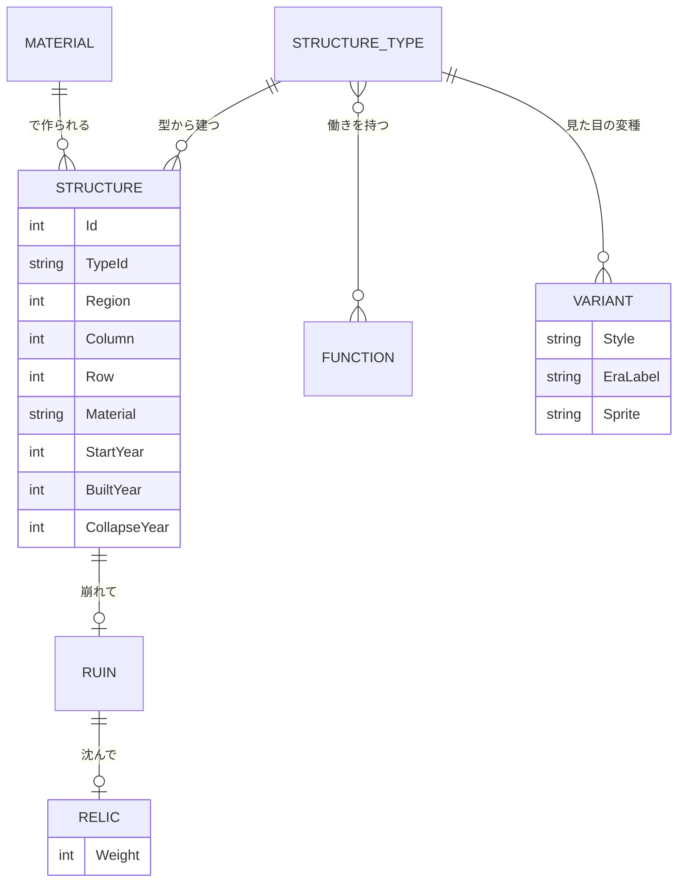

# 仕様書: 構造物（人が作って世界に残る物の決め方）

- テスト仕様書: なし（実装する段で書く）
- 関連ADR: なし
- 通信: なし
- 画面デザイン: なし

> 2026-11-09 に書いた。神託の読みの跡（祭壇・柵・切り株・壁。[字の神託](script-decipher.md)の 9 章）を画面に出す前に、「建物」と呼べる物が 6 つの仕様書に別々に決まっていたのを整理した。開発者の依頼「世の中にある構造物をできるだけ再現できるようにし、そのうえでこのゲームの仕様に落とし込む」に沿って AI が下書きを書き、開発者が別の AI（Gemini）と壁打ちした結果（`memo/structure.md`）を突き合わせて直した。分け方・働き・層・型の項目・状態遷移は、AI の推奨を人間が一覧で確認して決めた（2026-11-09）。数値（寿命・大きさ・建てる手間・遺物の重み）はゲームデータ定義に置き、遊んで決める。

## 目的

世の中の構造物（家・神殿・畑・道・堤防・墓・柵・碑…）を、このゲームの中でできるだけ再現できるようにする。そのために、次の 2 つを両立させる。

- **数を増やしても計算が膨らまない**: 構造物の種類が 100 を超えても、シミュレーションが扱う区別は少なく保つ。
- **見て分かる**: 人が建て、使い、朽ち、埋もれ、後の人に掘り当てられる様子を、1 つずつ眺められる（[人の欲求](agent-needs.md)）。

## ゲームのルール

用語は [用語集](glossary.md) に合わせる。

### 1. 基本の考え方: 計算は「働き」、見た目は「様式 × 材料 × 時代」

- 構造物は、人が作って世界に残る物すべてを指す。神が作った地形（湖・山）と、人が持ち歩く道具・乗り物は含めない。
- シミュレーションは、構造物を**働き**（2 章）と、型が持つ**大きさ・建てる手間**（4 章）で区別する。ピラミッドと聖堂は、どちらも「祈る」働きの建物だが、大きさと建てる手間が違うので、社会にかかる重さも、後の時代に残す重みも違う。様式の違いは見た目だけにする。
- 見た目は、**構造物の型 × 建築の様式 × 材料 × 時代の名札**で選ぶ（[文化の種類](culture-kinds.md)の「建築の様式」と、[発明の木](invention-tree.md)の時代の名札をそのまま使う）。
- 現実の構造物を 1 つ足すときは、次の順で考える。
  1. 既存の型の見た目の変種で足りるか（例: ゲル・ティピーは「住まい」の天幕の様式）。足りれば絵と名前だけ足す。
  2. 足りなければ、既存の働きの組み合わせで新しい型を作る（例: 灯台 ＝ 示す ＋ 通る）。データ定義に 1 行足すだけにする。
  3. それでも表せない働きのときだけ、働きを足す。働きを足すのは仕様の変更で、人間が決める。
- 働きの組み合わせは、データ定義に書いた型だけが建つ。誤読や誤解が、働きを勝手に組み合わせた新しい型を作ることはない（現実の言葉に置けない構造物と、絵の数が増えすぎるのを防ぐ）。

### 2. 働き（17）

構造物が計算に効く理由。1 つの型は 1〜3 つの働きを持つ。効き目の中身は、それぞれの仕様書が決める（ここでは決めない）。

| 働き | 計算への効き目 | 効き目を決める仕様書 |
| :--- | :--- | :--- |
| 住む | 人が暮らす。人の上限・眠る場所 | [人の欲求](agent-needs.md)・[人の数](population.md) |
| 作る | 技術を伸ばす・道具や品を作る | [文明の創発的な発展](emergent-progression.md)・[経済](economy.md) |
| 掘る | 再生しない資源（石・鉱石）を掘る。地形を戻らない形で変え、足元の遺物を掘り当てるきっかけになる | [地層](strata.md)・[資源の使い方](resource-use.md) |
| 育てる | 食料・木を作る（再生する） | [食料の生産](food-production.md) |
| 蓄える | 食料・品を年をまたいで持つ | [食料の生産](food-production.md)・[経済](economy.md) |
| 祈る | 文化を伸ばす・信仰を保つ・巡礼を集める | [信仰](dogma-belief.md)・[聖地](holy-site.md)・[宗教](religion.md) |
| 葬る | 死者を残す。聖地のきっかけ | [聖地](holy-site.md)・[人の欲求](agent-needs.md) |
| 癒やす | 病と傷を治し、病人を隔てて疫病の広がりを抑える | [疫病](plague.md)・[衛生](sanitation.md) |
| 守る | 戦と災いから守る | [地域間の戦争](warfare.md)・[国と集落](polity.md) |
| 治める | 国・集落のまとまり | [国と集落](polity.md)・[貴族と家](nobility.md) |
| 学ぶ | 学問を伸ばす・記録を残す | [学問](academics.md) |
| 楽しむ | 娯楽・交流 | [娯楽](entertainment.md) |
| 商う | 市場・交易 | [経済](economy.md)・[運送と物流](logistics.md) |
| 水を扱う | 水を引く・せき止める・汚れを流す | [治水と水利](water-control.md)・[衛生](sanitation.md) |
| 通る | 人と物が行き来する | [運送と物流](logistics.md)・[交通](transit.md) |
| 示す | 境・記憶・教えを刻む。後の人が読む | [字の神託](script-decipher.md)・[国と集落](polity.md)・[地層](strata.md) |
| 動かす | 力を作る（水車・風車・発電） | [エネルギー](energy.md) |

- 「掘る」は「作る」と分ける。畑や森は育て直せるが、石切り場や鉱山は掘った分だけ地形が変わり、戻らない。[地層](strata.md)の「発掘は、人の行動から起きる」（鉱脈を掘る・井戸を掘る・土台を作る）の引き金を、この働きで持つ。
- 「癒やす」は、[疫病](plague.md)の手立て（薬草・隔離・検疫・上下水道）を置く先にする。手立ての効き目は、今のまま発明と信仰の行動で決まる。構造物は、その手立てが地域にあることを見せ、どこで行われているかを決める。
- 「水を扱う」は、[治水と水利](water-control.md)が独自の仕組み（堤防・用水路・ダム・決壊）を持つので、ほかの働きにまとめない。

### 3. 置き方（6 つの層）

構造物は、世界のどこにどう置かれるかで 6 つの層に分ける。層が、セーブに残すか・地層に沈むか・歴史を持つかを決める。

| 層 | 置き方 | 例 | セーブ | 歴史（誰が・いつ・何のため） | 地層に残るか |
| :--- | :--- | :--- | :--- | :--- | :--- |
| A. 建物 | 枠（小 ＝ 今の 2 × 2 マス、中・大は枠をまとめて）を占める | 家・工房・祠・霊廟・聖堂・巨大な像・ピラミッド、これからの神殿・図書館・工場 | する | 持つ | 材料による（5 章） |
| B. 土地の使い方 | タイルを占める面。建物にしない | 畑・牧場・果樹園・塩田・石切り場・鉱山 | する | 持たない（持ち主の集落だけ） | 残らない |
| C. 網 | 地域の境（隣り合う辺）に持つ線 | 道・橋・水路・運河・航路・鉄道・堤防・城壁・長城 | する（等級だけ） | 持たない | 残らない |
| D. 印 | 枠を占めない点 | 刻まれた字（目印・札・碑）・墓・境界の印・読みの跡 | する | 持つ | 材料による（5 章） |
| E. 物の跡 | 値から毎回描く、見た目だけの物 | 怒りの柵・防壁・煙・灰・祭りの火・踏み跡 | しない | 持たない | 残らない |
| F. 計算上の場 | 地域の値だけ。集落の絵の一部として描く | 市場・娯楽の場・広場 | 値だけ | 持たない | 残らない |

- 建物（A）は「枠を占める物」で、人が中で暮らすかは問わない。巨大な像やピラミッドも建物に入る。
- 長い壁（城壁・長城）は網（C）にし、地域の境に「壁の等級」を持たせる。城門は、壁の等級を持つ辺の上の道の等級で表す（門だけの構造物は作らない）。読みの跡の壁（字の神託の 9 章）は短い壁で、印（D）のままにする。
- 同じ見た目の物が 2 つの層にまたがってよい。例: 柵は、読みから生まれたものは**印**（信者が減っても残る歴史の跡）、怒りから生まれたものは**物の跡**（値が下がれば消える）。絵は同じでよい。
- 印は、今の刻まれた字の一覧（[字の神託](script-decipher.md)）とは別の一覧に持つ。字の一覧は読み直しの仕組みと深く結びついているので、まとめるかは境界の印を作るときに考える。
- 土地の使い方（B）と網（C）は地層に残さない（古い道・肥えた土・掘った穴を残すかは、必要になってから決める）。

### 4. 構造物の型（データ定義の項目）

構造物の型は、ゲームデータ定義（`game/data/structures.json`）に 1 行ずつ持つ。コードに型ごとの分岐を書かず、項目だけで振る舞いが決まるようにする。

| 項目 | 内容 |
| :--- | :--- |
| ID | `STRUCT_HOUSE` のような英大文字の ID |
| 層 | 3 章の A〜F |
| 働き | 2 章から 1〜3 つ |
| 大きさ | 建物は小・中・大（枠をいくつまとめて占めるか）、土地の使い方はタイル数、印は点 |
| 使える材料 | 5 章から。地域で手に入る材料と、技術の段階で 1 つ選ぶ |
| 要る発明 | [発明の木](invention-tree.md)のノード。無ければ最初から建てられる |
| 建てる者 | 住人が自分で / 集落が / 国が / 信者が / 神託の読みの結果 |
| 建てる手間 | 建て終えるまでの年数と、その間に工事に取られる人の割合。大きな構造物ほど重い（6 章） |
| 寿命 | 材料の寿命 × 型の倍率。修繕される条件（例: 信者がいる間。[聖地](holy-site.md)） |
| 見た目の変種 | 建築の様式 × 時代の名札ごとの絵の名前 |

- 数値（大きさの枠数・建てる手間・寿命）は、遊んで決める。今の「小 ＝ 2 × 2 マス」だけが決まっている。

### 5. 材料

材料は、見た目と、どれだけ長く残るか（地層に残るか）を決める。寿命の数値はデータ定義で決める。

| 材料 | 手に入る所（案） | 寿命の傾向 | 地層に残るか |
| :--- | :--- | :--- | :--- |
| 草・わら | 草原・温帯 | 短い | 残らない |
| 皮・フェルト | 草原・乾地（遊牧） | 短い | 残らない |
| 雪・氷 | 極 | とても短い（季節） | 残らない |
| 木・竹 | 森 | 中 | 残らない |
| 土・日干しれんが | 乾いた所・川べり | 中 | 土台だけ残る |
| 焼きれんが | 粘土の平野（燃料が要る） | 長い | 残る |
| 石 | 山・台地 | とても長い | 残る |
| 金属 | 鉱山（発明が要る） | 長い（錆びる） | 残る |
| コンクリート・ガラス | 発明が要る | 長い | 残る |

- 「残らない」材料の構造物は、廃墟になってから沈む年数がたつと、地下に沈まずに消える。今の建物は材料を区別せずに沈むので、この決まりを入れるときに[地層](strata.md)の決まりも合わせて直す。
- 今の家 3 種（わらぶき・木組み・れんが）は、「住まい」の型 1 つ × 材料 3 つと読み替える。コードの `BuildingType` を型 × 材料に作り直すのは、[文化の種類](culture-kinds.md)の段 8（様式 × 時代の絵を作る段）でまとめて行う。読みの跡を出す段 3 では作り直さず、印の一覧だけを足す。

### 6. 建てる手間と、遺物の重み

- **大きな構造物は、建て終えるまで何年もかかる**。その間、地域の人の一部（建てる手間で決まる割合）が工事に取られ、畑や工房の仕事が減る。信仰のために暮らしがすり減る様子が、食料の減りと、足場に集まる人の姿で見える。
- **欠乏の危機では工事を止める**: 地域の危機が欠乏（[字の神託](script-decipher.md)の 9 章）のあいだは、工事に人を取らない。建てている途中のまま残り、欠乏が終われば続きから建てる。工事のせいで飢えて全滅するのを防ぐ安全弁。
- **遺物の重み ＝ 建てる手間 × 大きさ**: 構造物が地下に沈んで遺物になるとき、この重みを残す。掘り当てたときの二次誤解（[地層](strata.md)）は、重い遺物ほど強く効く。強さの式と上限は、地層の仕様を決め直すときに決める。
- 工事を始めたこと・工事で人手が足りないこと・重い遺物を掘り当てたことは、年表に残す（なぜ飢えたのか、なぜ新しい教えが急に広がったのかを、神が後から辿れるようにする）。

### 7. 重なっていた物の整理

| 物 | 今までの決まり | 整理 |
| :--- | :--- | :--- |
| 柵・防壁 | 物の跡（怒りで増える。[感情の見える化](emotion-visuals.md)）と、読みの跡（境を閉ざす・武器と壁にする。[字の神託](script-decipher.md)） | 読みの跡は印、怒りの柵は物の跡。絵は共通 |
| 壁 | 読みの跡の壁と、城壁・長城 | 読みの跡の短い壁は印、長い壁は網（3 章） |
| 石碑 | 神託の碑（字）と、境界の印の石碑（[国と集落](polity.md)） | どちらも「石の印」の型 1 つで、示す中身が違うだけ |
| 祠 | 建物の祠と、境界の印の「境界の祠」 | 建物の祠はそのまま。境界の祠は印（点に置く小さな祠） |
| 祭壇・切り株 | どこにも決まりが無かった | 印に入れる（祭壇 ＝ 祈る ＋ 示す、切り株 ＝ 示す。切り株は木を伐った跡で、森林量の値ではなく 1 本ずつの跡として残す） |
| 市場・広場 | 計算上の場（[経済](economy.md)で決定済み） | そのまま F。絵は集落の絵の一部 |

### 8. 状態遷移

建物（A）と印（D）に共通する。今の建物・廃墟・遺物（[地層](strata.md)）の決まりを、印と建てている途中の物にも広げた形。土地の使い方・網・物の跡・計算上の場は状態を持たない。

建てる手間が 0 の型（今の家・工房・祠、小さな印）は、建てている途中を飛ばして、建った年から「建っている」になる。

| 現在の状態 ＼ きっかけ | 工事が終わる | 寿命が来る | 壊される（狂乱・戦・災害・火を放つ） | 放置の年数がたつ | 上に建て増す | 修繕の条件を満たす | マクロ沈下（地域の崩壊・大災害） |
| :--- | :--- | :--- | :--- | :--- | :--- | :--- | :--- |
| 建てている途中 | 建っている | 不可 | 廃墟 | 廃墟（工事が止まったまま放置の年数がたった） | 不可 | 建てている途中 | 地下（残る材料）／消えた（残らない材料） |
| 建っている | 不可 | 廃墟（修繕の条件を満たしていれば建っているまま） | 廃墟 | 不可 | 不可 | 建っている | 地下（残る材料）／消えた（残らない材料） |
| 廃墟 | 不可 | 不可 | 不可 | 地下（残る材料）／消えた（残らない材料） | 廃墟のまま（上に新しい構造物が建つ） | 不可 | 地下（残る材料）／消えた（残らない材料） |
| 地下 | 不可 | 不可 | 不可 | 不可 | 不可 | 不可 | 地下のまま |
| 消えた | 不可 | 不可 | 不可 | 不可 | 不可 | 不可 | 不可 |

- 欠乏の危機で工事が止まっても、状態は「建てている途中」のまま（6 章）。止まったまま放置の年数がたつと、未完の廃墟になる。
- 「地下」から掘り当てられる流れ（発掘と二次誤解）は、[地層](strata.md)が決める。

### 9. 見せ方

構造物の一生の、切り替わる瞬間と経過を見せる（詳細の視点。[視点](camera-views.md)）。

| 一生 | 見せ方 |
| :--- | :--- |
| 建てている途中 | 足場が組まれ、下から少しずつ形が積み上がる。工事の人が集まり、ほかの場所は閑散とする |
| 使われている | 人の行き来。よく通る所の草が剥げて土の踏み跡になる（物の跡） |
| 廃墟 | 屋根が落ち、壁の隙間から草やつたが生える |
| 地下へ沈む | 土と砂が下半分から覆い、最後は小高い丘や、地面から突き出た石の角になる |

- 廃墟（まだ枠を占める）と、地下に沈んだ跡（上に建てられる）は、見た目ではっきり分ける（沈んだ跡は彩度を下げ、地面に半分溶け込ませる）。
- 絵の作り方（部品の重ね合わせ・材料ごとの色の差し替え）は、段 8 で絵を作るときに決める。[文化の種類](culture-kinds.md)の「細分けは色の差し替えと飾りで出す」に合わせる。

## 現実の構造物の一覧

「型」はゲームの中の構造物の型（4 章）。同じ型の行は、見た目の変種として再現する。「状態」は、実装 ＝ コードにある、仕様 ＝ 仕様書にある、候補 ＝ この一覧で初めて挙げた。時代は [発明の木](invention-tree.md)の大きな名札（原始・古代・中世・近代）。どの候補をどの段で入れるかは、それぞれの仕様書の段に合わせる（段 3 で入れるのは祭壇・柵・切り株・壁だけ）。

### 住む
| 現実の構造物 | 型 | 層 | 主な材料 | 時代 | 状態 |
| :--- | :--- | :--- | :--- | :--- | :--- |
| 竪穴住居・芝の家 | 住まい | A | 土・木・草 | 原始 | 仕様（様式） |
| わらぶき小屋・円い草の家 | 住まい | A | 草・木 | 原始〜 | 実装（わらぶき） |
| 高床の家・水上の家 | 住まい | A | 木・竹 | 原始〜 | 仕様（様式） |
| ゲル・ティピー・黒い天幕 | 住まい | A | 皮・フェルト | 原始〜 | 仕様（様式） |
| イグルー | 住まい | A | 雪 | 原始〜 | 仕様（様式） |
| 日干しれんがの家・塔の家 | 住まい | A | 日干しれんが | 古代〜 | 仕様（様式） |
| 木組みの家・丸太小屋・ロングハウス | 住まい | A | 木 | 古代〜 | 実装（木組み） |
| れんがの家 | 住まい | A | 焼きれんが | 古代〜 | 実装（れんが） |
| 石の家 | 住まい | A | 石 | 古代〜 | 仕様（様式） |
| 岩窟の家・地下の町 | 住まい | A | 石 | 古代〜 | 仕様（様式） |
| 長屋・集合住宅 | 大きな住まい | A（中） | れんが・木 | 古代〜 | 候補 |
| 館・屋敷 | 館（住む ＋ 治める） | A（中） | 石・木 | 中世〜 | 候補（[貴族と家](nobility.md)） |
| 宮殿 | 館（住む ＋ 治める） | A（大） | 石 | 古代〜 | 候補 |
| 修道院 | 修道院（祈る ＋ 学ぶ ＋ 蓄える） | A（中） | 石 | 中世〜 | 候補 |
| 高層の集合住宅 | 大きな住まい | A（中） | コンクリート | 近代 | 候補 |

### 作る・掘る・動かす
| 現実の構造物 | 型 | 層 | 主な材料 | 時代 | 状態 |
| :--- | :--- | :--- | :--- | :--- | :--- |
| 鍛冶場・陶房・織り場 | 工房 | A | 木・れんが | 古代〜 | 実装（工房） |
| 炭焼き窯・製鉄の炉 | 工房（変種） | A | 土・石 | 古代〜 | 候補 |
| 石切り場 | 石切り場（掘る） | B | 石 | 古代〜 | 候補 |
| 鉱山の坑口 | 鉱山（掘る） | B | 土・石 | 古代〜 | 候補 |
| 水車小屋 | 水車（作る ＋ 動かす） | A | 木 | 古代〜 | 候補（[エネルギー](energy.md)） |
| 風車 | 風車（作る ＋ 動かす） | A | 木・石 | 中世〜 | 候補（[エネルギー](energy.md)） |
| 時計塔 | 時計塔（動かす ＋ 示す） | A | 石 | 中世〜 | 候補 |
| 工場 | 工場 | A（中） | れんが・金属 | 近代 | 仕様（[大気の汚れ](air-pollution.md)の未決） |
| 発電所 | 発電所（動かす） | A（大） | コンクリート・金属 | 近代 | 候補（[エネルギー](energy.md)） |

### 育てる・蓄える
| 現実の構造物 | 型 | 層 | 主な材料 | 時代 | 状態 |
| :--- | :--- | :--- | :--- | :--- | :--- |
| 畑・水田・段々畑 | 畑 | B | 土 | 原始〜 | 仕様（[食料の生産](food-production.md)） |
| 牧場・柵囲い | 牧場 | B | 木 | 原始〜 | 仕様（[食料の生産](food-production.md)） |
| 果樹園・茶畑・植林地 | 畑（変種） | B | 木 | 古代〜 | 候補 |
| 塩田 | 塩田 | B | 土 | 古代〜 | 候補 |
| 温室 | 温室 | A | ガラス | 近代 | 候補（[温室](greenhouse.md)） |
| 穀物倉・高床倉 | 倉 | A | 木・土 | 原始〜 | 候補 |
| 地下の貯蔵穴・氷室 | 倉（変種） | D | 土・石 | 原始〜 | 候補 |

### 祈る・葬る
| 現実の構造物 | 型 | 層 | 主な材料 | 時代 | 状態 |
| :--- | :--- | :--- | :--- | :--- | :--- |
| 祠・小さな社 | 祠 | A | 木・石 | 原始〜 | 実装（祠） |
| 祭壇・供物台 | 祭壇（祈る ＋ 示す） | D | 石・木 | 原始〜 | 仕様（読みの跡） |
| 立石・環状列石 | 立石（祈る ＋ 示す） | D | 石 | 原始〜 | 候補 |
| 神殿・聖堂・塔の寺・モスク | 大きな祈りの建物 | A（中〜大） | 石・れんが・木 | 古代〜 | 一部仕様（聖堂。[聖地](holy-site.md)） |
| ピラミッド・ジッグラト | 大きな祈りの建物（葬る ＋ 祈る ＋ 示す） | A（大） | 石・日干しれんが | 古代 | 候補 |
| 巨大な像 | 巨像（示す ＋ 祈る） | A（中〜大） | 石・金属 | 古代〜 | 候補 |
| 墓（土饅頭・墓石） | 墓 | D | 土・石 | 原始〜 | 実装（墓） |
| 霊廟・古墳 | 霊廟 | A（中〜大） | 石・土 | 古代〜 | 仕様（[聖地](holy-site.md)） |
| 地下墓地 | 霊廟（変種） | A | 石 | 古代〜 | 候補 |

### 癒やす
| 現実の構造物 | 型 | 層 | 主な材料 | 時代 | 状態 |
| :--- | :--- | :--- | :--- | :--- | :--- |
| 薬草園 | 薬草園（育てる ＋ 癒やす） | B | 土 | 古代〜 | 候補（[疫病](plague.md)の薬草） |
| 治療院・病院 | 病院（住む ＋ 癒やす） | A（中） | 石・れんが | 古代〜 | 候補（[疫病](plague.md)） |
| 隔離の小屋・検疫所 | 検疫所（癒やす ＋ 守る） | A | 木・石 | 中世〜 | 候補（[疫病](plague.md)の隔離・検疫） |

### 守る・治める
| 現実の構造物 | 型 | 層 | 主な材料 | 時代 | 状態 |
| :--- | :--- | :--- | :--- | :--- | :--- |
| 柵・生け垣（読みから） | 柵 | D | 木 | 原始〜 | 仕様（読みの跡） |
| 柵・防壁・見張り台（怒りから） | ― | E | 木・石 | 原始〜 | 仕様（[感情の見える化](emotion-visuals.md)） |
| 短い壁（読みから） | 壁 | D | 石・土 | 古代〜 | 仕様（読みの跡） |
| 城壁・長城・城門 | 壁 | C（壁の等級） | 石・土 | 古代〜 | 候補 |
| 木の杭・石碑・砦・境界の祠 | 境界の印 | D | 木・石 | 原始〜 | 仕様（[国と集落](polity.md)） |
| 城・要塞 | 城（住む ＋ 守る ＋ 治める） | A（大） | 石 | 中世〜 | 候補（[地域間の戦争](warfare.md)） |
| 役所・議事堂・裁きの場 | 治める建物 | A（中） | 石 | 古代〜 | 候補 |
| 兵舎 | 兵舎 | A | 木・石 | 古代〜 | 候補 |
| 牢・収容所 | （未定） | A | 石 | 古代〜 | 候補（働き「縛る」を足すかは未決） |

### 学ぶ・楽しむ・商う
| 現実の構造物 | 型 | 層 | 主な材料 | 時代 | 状態 |
| :--- | :--- | :--- | :--- | :--- | :--- |
| 書院・図書館・大学 | 学びの建物 | A（中） | 石・木 | 古代〜 | 仕様（[学問](academics.md)。段 9） |
| 天体観測所 | 学びの建物（変種） | A | 石 | 古代〜 | 仕様（[学問](academics.md)） |
| 広場 | ― | F | 土・石 | 原始〜 | 仕様（[人の欲求](agent-needs.md)の交流の行き先・[視点](camera-views.md)の街並み） |
| 劇場・円形闘技場・浴場 | 娯楽の場 | F | 石 | 古代〜 | 仕様（[娯楽](entertainment.md)） |
| 市・市場・隊商宿 | 市場 | F | 木・石 | 古代〜 | 仕様（[経済](economy.md)） |
| 港・波止場 | 港（通る ＋ 商う） | A | 木・石 | 古代〜 | 候補（[運送と物流](logistics.md)） |

### 水を扱う
| 現実の構造物 | 型 | 層 | 主な材料 | 時代 | 状態 |
| :--- | :--- | :--- | :--- | :--- | :--- |
| 井戸 | 井戸（水を扱う ＋ 掘る） | D | 石・木 | 原始〜 | 候補（ロードマップの基本の建物） |
| 用水路・水路 | 水路 | C | 土・石 | 古代〜 | 仕様（[治水と水利](water-control.md)） |
| 堤防 | 堤防 | C（川沿いの線） | 土・石 | 古代〜 | 仕様（[治水と水利](water-control.md)） |
| ため池・ダム | ダム | A（大） | 土・コンクリート | 古代〜 | 仕様（[治水と水利](water-control.md)） |
| 水道橋・地下水路 | 水路（変種） | C | 石 | 古代〜 | 候補 |
| 下水・汚水溜め | 下水 | C | 石・れんが | 古代〜 | 仕様（[衛生](sanitation.md)） |

### 通る・示す
| 現実の構造物 | 型 | 層 | 主な材料 | 時代 | 状態 |
| :--- | :--- | :--- | :--- | :--- | :--- |
| 獣道・踏み分け道・街道・舗装路 | 道 | C | 土・石 | 原始〜 | 仕様（[経済](economy.md)の道の網） |
| 橋 | 道（川を渡る辺の等級） | C | 木・石・金属 | 古代〜 | 候補 |
| 運河・航路 | 水路・航路 | C | ― | 古代〜 | 仕様（[経済](economy.md)） |
| 鉄道・駅 | 鉄道 | C（駅は A） | 金属 | 近代 | 仕様（[交通](transit.md)） |
| 灯台 | 灯台（示す ＋ 通る） | A | 石 | 古代〜 | 候補 |
| 目印・札・神託の碑 | 刻まれた字 | D | 石・木 | 原始〜 | 実装（[字の神託](script-decipher.md)） |
| 記念碑・オベリスク・凱旋門 | 記念碑 | D（大きいものは A） | 石・金属 | 古代〜 | 候補 |
| 切り株（伐った跡） | 切り株 | D | 木 | 原始〜 | 仕様（読みの跡） |

### このゲームならではの構造物（見た目の変種の案）

神託の読み違えや遺物の誤解から生まれる物。規則は増やさず、既存の型の**見た目の変種**として、建った理由（読み・掘り当てた遺物）で絵を選ぶ。字の神託の 9 章の「名詞ごとの見た目の違いは後で入れる」と同じ時期に入れる。

| 構造物 | 型 | 生まれ方 |
| :--- | :--- | :--- |
| 継ぎはぎの城壁 | 壁 | 掘り出した昔の祭壇・石像・碑を、資材として積み上げた壁。いくつもの時代の様式が混ざって見える |
| 空洞の聖地 | 印（何も無い枠） | 禁忌で誰も建てない空き地。まわりが建て増しで高くなる中、窪地として残り、後の時代に聖地と誤解される |
| 封水の塔 | 大きな祈りの建物 | 水の禁忌を守るため、雨が地面に触れないよう覆った塔。掘り当てた後の人は、水を蓄える聖なる施設と誤解する |
| 木を戴く塔 | 大きな祈りの建物 | 昔の切り株の上に土を積み、頂に生きた木を植えた塔。森を伐った時代の後に、木の崇拝が強まった地域に建つ |
| 祭壇の炉 | 工房 | 掘り当てた昔の石の祭壇を、炉の台座にしたもの。刻まれた模様の上に煙突が立つ |

### 入れないもの
| 現実の構造物 | 理由 |
| :--- | :--- |
| 家具・内装 | 構造物の内側。詳細の視点でも 32 px の外観だけを描く |
| 一時的な仮設（屋台） | 年単位の計算で残らない。必要なら物の跡（E）。工事の足場は、建てている途中の絵に含める |
| 道具・乗り物 | 人が持ち歩く物で、構造物ではない |

## 受け入れ条件

段 3（読みの跡を画面に出す）で関わる条件から、テスト仕様書に落とす。

| ID | Given（前提） | When（操作） | Then（結果） |
| :--- | :--- | :--- | :--- |
| AC-structures-001 | 同じ型で、見た目の変種だけが違う 2 つの構造物（例: 石の家とわらぶき小屋） | 同じ地域・同じ年に建っている | 計算への効き目は同じで、絵だけが違う |
| AC-structures-002 | 石の印と木の印が同じ地域に建っている | その地域がマクロ沈下する | 石の印は地下に残り、木の印は消える |
| AC-structures-003 | 読みから生まれた柵と、怒りから生まれた柵が同じ地域にある | カオス度が怒りの区切りより下がる | 怒りの柵は消え、読みの柵は残る |
| AC-structures-004 | 新しい型をデータ定義に 1 行足す（既存の働きだけを使う） | ゲームを起動する | コードを変えずに、その型の構造物が建つ |
| AC-structures-005 | 建てる手間のある大きな建物を工事している地域 | 地域の危機が欠乏になる | 工事に人を取らなくなり、建物は建てている途中のまま残る。欠乏が終わると続きから建てる |
| AC-structures-006 | 建てる手間の大きい建物と小さい建物が、同じ年に地下に沈む | 遺物になる | 大きい建物の遺物のほうが重みが大きい |

## 対象外

- 構造の力学（荷重・崩れ方の物理）。崩れるのは寿命と壊される出来事だけで決める。
- 構造物ごとの耐久の値（傷み）。[大気の汚れ](air-pollution.md)で、耐久を持たないと決めている。
- 神が構造物を直接建てること。構造物は人が建てる（神は神託で向きを付けるだけ）。
- 構造物の内部（部屋・家具）。
- 誤読が働きを勝手に組み合わせて新しい型を作ること（1 章）。

## 決まったこと（2026-11-09）

AI の推奨を、人間が一覧で確認して決めた。

1. 6 つの層で分ける（3 章）。建物（A）は「枠を占める物」とし、長い壁は網（C）に寄せる。
2. 計算は働き・大きさ・建てる手間で、見た目は様式 × 材料 × 時代で分ける（1 章）。
3. 働きは 17。壁打ちの案から「掘る」「癒やす」を足し、「水を扱う」は残した（2 章）。
4. 読みの跡（祭壇・柵・切り株・壁）は印に入れる。
5. 印は、刻まれた字と別の一覧に持つ。
6. 大きな構造物は枠を複数まとめて占める。枠数は遊んで決める。
7. 材料で地層に残るかを決める（5 章）。
8. 今の `BuildingType` の作り直しは段 8 で行う。段 3 では印の一覧だけ足す。
9. 型のデータ定義は `game/data/structures.json` に分ける。
10. 土地の使い方・網は地層に残さない。
11. 建てる手間と、欠乏で工事を止める安全弁を入れる（6 章）。
12. 遺物の重み ＝ 建てる手間 × 大きさ（6 章）。
13. このゲームならではの構造物は、見た目の変種として扱う。

壁打ちの案のうち、次は採らなかった。
- 1 地域の宗派を 2 つまでにし、発掘で派閥を吸収する案: 字の神託の 9 章では宗派の数に上限を設けず、追放はカオス度の閾値で決めている。
- 寿命を待ち行列で管理する案: 今のコードは、建った時に崩れる年を決めていて、考え方は同じ。今の規模では待ち行列は要らない。

## 未決

1. **働き「縛る」（牢・収容所）を足すか**: どの仕様書にも無い。異端と追放（字の神託の 9 章）につながる。今は候補に置くだけ。
2. **遺物の重みが二次誤解に効く強さの式と上限**: [地層](strata.md)の発掘と二次誤解を決め直すときに決める。
3. **発掘のきっかけで、二次誤解の動詞を決める案**（掘って当てたら「壊せ」、記念碑の土台で当てたら「崇めよ」）: 地層では「遺物の教えが読み違えられて人の教えになる」と決めている。地層の仕様を決め直すときまで保留。
4. **数値**: 大きさ（中・大の枠数）、建てる手間（年数・人の割合）、材料ごとの寿命、未完の廃墟になるまでの放置の年数。遊んで決める。
